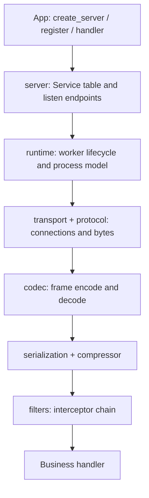
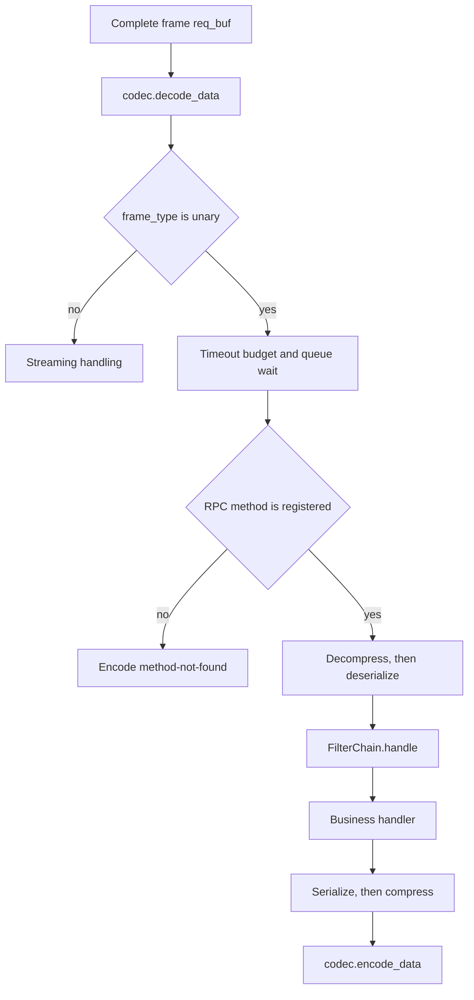
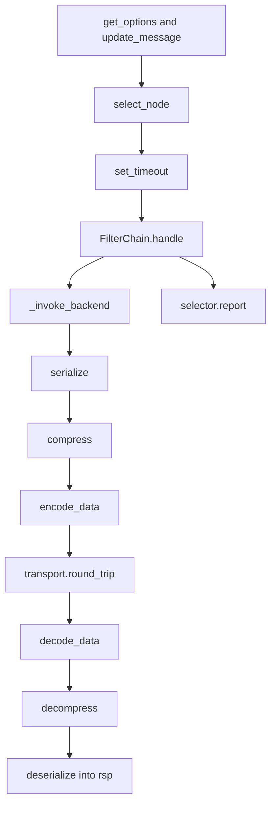
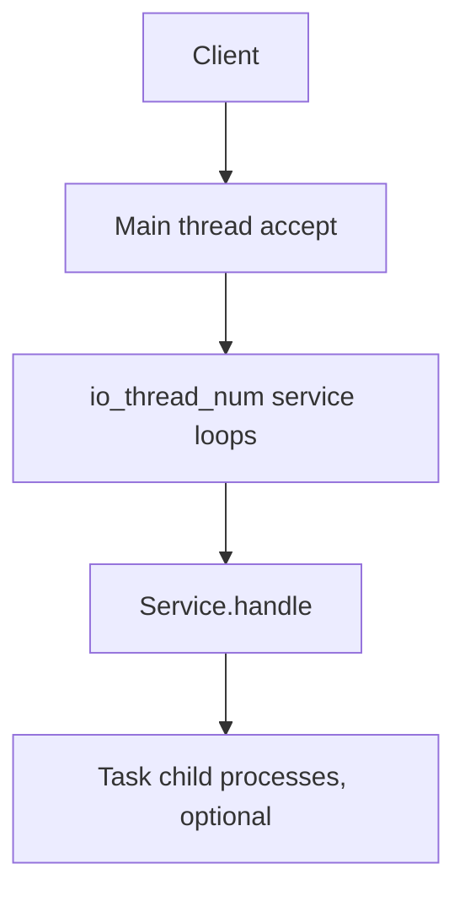
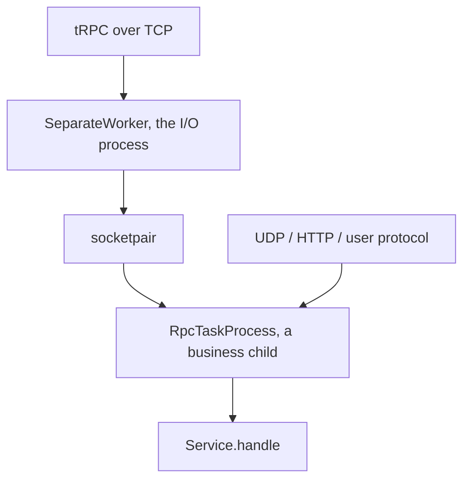
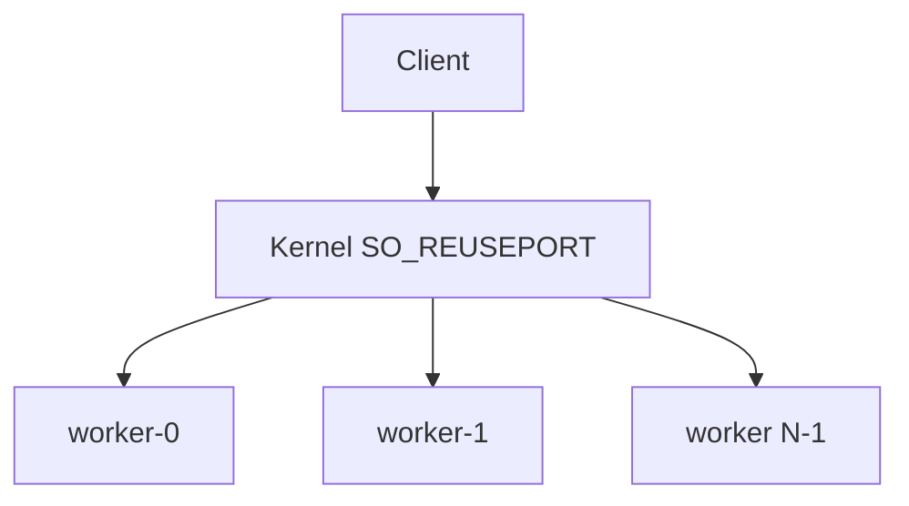
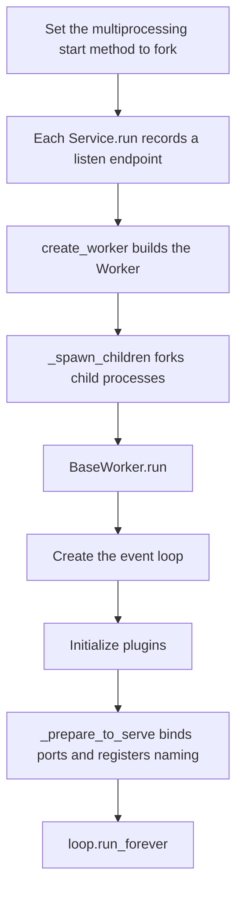

English | [中文](architecture.zh_CN.md)

# tRPC-Python Architecture

This page explains how the tRPC-Python framework is layered, how one unary RPC runs from start to finish, and how processes and threads divide the work. After reading it, you can tell which module a request passes through, which process it runs in, and which plugin slot is attached at each stage of the call path.

How a plugin is registered, how a filter is written, and how the four protocol slots are attached are in [Plugin Basics](develop_plugins/plugin.md), [Filter Plugin](develop_plugins/filter.md), and [Protocol Plugin](develop_plugins/protocol.md). This page focuses on where those extension points sit on the call path and how they work together.

## Layers

Application code does three things: `create_server` reads the YAML and builds a `Server`, the generated stub `register`s RPC methods onto each `Service`, and the business handler handles a request object that has already been deserialized. After `Server.serve()`, the process lifetime is handed to the `runtime` package.

The core packages divide the work as follows:

- **[`trpc_sdk.server`](../../trpc_sdk/server/__init__.py)** holds the `service_name -> Service` table. `TrpcServerAdapter` only records the listen address, handler, checker, and timeout into its internal tables. It does not listen, and it does not `fork`.
- **[`trpc_sdk.runtime`](../../trpc_sdk/runtime/__init__.py)**: `BaseWorker` is the lifecycle template shared by every service process. The framework picks a worker from `ServerOption.mode`, which is parsed from `global.processmodel`:
  - `merge` uses `MergeWorker` (its subclass `SeparateThreadWorker` when `io_handle_type: separate`);
  - `separate` uses `SeparateWorker`.

Moving bytes and parsing a frame are three separate layers:

- **`transport`**: how bytes move. The client keeps a connection pool and runs one `round_trip`. The server records listen parameters at `bind` and calls `listen` after `fork`. The runtime walks the transports and asks each one what it is (a user protocol or not, `ipc_forwardable` or not) to decide which process and which event loop listens on each address.
- **`protocol`**: `protocol.TCPConnection` is attached to a TCP socket this process has already `accept`ed. It splits frames with the checker and writes the response back on the same connection. `ConnWriter` lets another thread write on that connection safely.
- **`codec`**: the frame header and body inside one frame. The checker only splits a complete frame out of the byte stream. It does not parse the business protocol body.

Cross-cutting packages are not on the arrow above. The call path fetches them by name from the plugin registry at runtime: `plugin` is that registry, and `filters`, `serialization`, `compressor`, `naming`, and `config` all take their instances from it.

## One Server Unary Request

On TCP, each connection has its own checker. When `data_received` gets new bytes, `feed_data` writes them into the buffer, then `read` pulls out frames that are already complete. Only after one full frame (`req_buf`) has been split out does the call enter `Service.handle`.

`Service.handle` runs in this order:

1. **Decode the frame and branch.** `decode_data` writes the frame header and the protocol header into this call's `TrpcMessage` and returns the body bytes. If the frame type is not `unary`, the call leaves this path before the timeout check and is handed to the registered streaming method.
2. **Queue wait and timeout.** Only a unary request checks the queue wait and merges the timeout budget. When `check_timeout` is on and the request waited too long in the queue, the framework encodes a timeout error response and returns.
3. **Find the method and deserialize.** The method name comes from `message.get_server_rpc_name()`. After a `Method` is found, `req_cls()` builds an empty request object. The body is decompressed by `message.compress_type`, then deserialized into that object by `message.serialization_type`. The `req` a filter receives is already this business object.
4. **Filter chain and business handling.** `FilterChain.handle` wraps the business function. A filter earlier in the YAML `filter` list sits on the outside: its pre-logic runs first, and its post-logic runs last. The chain returns `(rsp, error)`. When there is no error, the framework serializes and compresses the response object, then `encode_data` packs it into a response frame.
5. **Errors.** Both `TrpcException` and any other uncaught exception are encoded as a response frame that carries an error code and an empty body. The failure stays with this request. The worker keeps serving later requests.
6. **The HTTP branch.** An HTTP request goes through `Service.handle_http`. aiohttp has already placed the request on the context, so this path skips decompression and protobuf deserialization, and still enters the same filter chain. The return value is the result of that chain, not a tRPC binary frame.

## One Client Unary Call

The client uses the same kinds of slots as the server, in the opposite direction. Each `Client.invoke` builds a new `Options`, writes caller metadata, the serialization type, and the compression type onto the `TrpcMessage`, then selects a node. Node selection sits outside the filter chain.

1. **Select a node and report.** When `target` is `scheme://endpoint`, `scheme` is the registered name of a `NAMING_SELECTOR`. `select_node` takes that plugin with `get_selector` and calls `select`, then writes the chosen address back onto the message. When the call ends, whether it succeeded or raised, `finally` calls `selector.report` with the result and the elapsed time.
2. **The inner send and receive (`_invoke_backend`).** This is the innermost part of the filter chain. It serializes and compresses the request by the types on the message, calls `encode_data` to build a complete request frame, then sends it with `transport.round_trip`. The client checker runs while the response is read: `read_frame` reads one full frame from a connection in the pool. After that, `decode_data`, decompress, and deserialize fill the `rsp` object the caller built in advance.
3. **How protocol pieces are bound.** The server's `service.protocol` and the client's `set_protocol` use the same protocol-name string to look up the `codec`, the `checker`, and an optional `transport`. When the client cannot find a custom `transport` of that name, it keeps the default `trpc` transport.

## Call Context and Message

Every RPC carries a `TrpcContext`, and that context holds one `TrpcMessage`. The server reads it with `get_message(ctx)`. The client reads it with `ctx.get_message()`. The codec, filters, timeout control, and node selection all cooperate by reading and writing this message.

### Fields and Methods on `TrpcContext`

Business code can use these directly:

- `deadline` and `timeout`. `get_timeout_ms()` returns the timeout in milliseconds. A value `<= 0` means no limit.
- `remote_ip` / `remote_port`, `local_ip` / `local_port`, and `recv_time`: the peer address, the local address, and the time the request was received.
- `with_meta_data`, `get_meta_data`, and `pop_meta_data` read and write the context's own `meta_data` dict. **That dict is visible only in this process** and is not sent on the wire. To pass key-value pairs across processes, use `client_meta_data` / `server_meta_data` on the message. The codec writes them into the frame header `trans_info`. See [Metadata Propagation](../user_guide/metadata_transmission.md).

### Architecture Fields on `TrpcMessage`

- `server_rpc_name`: the server uses it to find the registered RPC method.
- `serialization_type` and `compress_type`: integer enums, and the registered names of the `SERIALIZATION` and `COMPRESS` plugins. Outer framework code looks up those plugins by the integer. The codec itself does not.
- Caller metadata, the peer address, and the remaining timeout: node selection and timeout control write them here, and they travel to the peer with the frame.
- `server_rsp_err` and `client_rsp_err`: a business or framework error. The server encodes an error response frame from them. After the filter chain returns, if the client sees a failure code, it raises that error again.

### When the Timeout Budget Is Computed

Timeout is computed once on the server and once on the client. Both happen before the call enters the filter chain:

- **Server:** before the filters, it merges this service's timeout with the timeout passed in from upstream, and counts the time the request already waited in the queue.
- **Client:** before the filters, `set_timeout` takes the tighter of the configured client timeout and the remaining upstream `deadline`, and writes the time still available into the outgoing message.

## Process and Thread Model

The process started by `python trpc_main.py` is the root worker. `serve()` hands it to the worker class chosen from `global.processmodel`. That worker forks child processes and supervises them. The root process itself is started and watched by an external supervisor such as systemd or Kubernetes.

> **Why must `fork` happen before the event loop is created?**
> The `epoll` or `kqueue` file descriptor held by an event loop cannot be shared across `fork`, and the `socketpair` pipes used between processes must exist before the first `fork` so child processes inherit them. `serve()` therefore forces multiprocessing's start method to `fork`, and it forks every child process before the parent has created an event loop.

The framework supports three running modes, chosen by `global.processmodel`. The default is `merge`:

- `mode: single_process` + `io_handle_type: merge`
- `mode: single_process` + `io_handle_type: separate`
- `mode: multi_process` + `io_handle_type: separate` is **`separate` mode**
- `mode: multi_process` + `io_handle_type: merge`

### 1. Single-Process Mode

One process both `accept`s connections and runs business handlers. A request does not leave this process.

- **One thread or several threads, merged (`io_handle_type: merge`).** The default is one event loop. Both `accept` and the business handler run on it. When `io_thread_num` (YAML `io_num`, which must match `handle_num`) is greater than 1, the main thread `accept`s and hands each new connection to a service thread's event loop in turn. When it is 1, no extra thread is started. Each UDP socket is bound to the same address by every service loop with `SO_REUSEPORT`. User protocols and timers always run on service thread 0.
  - Threads in one process share one GIL. Waiting for network I/O, and C extensions that release the GIL, can overlap. Pure-Python CPU work does not spread across cores because of extra threads. That kind of service should use multi-process `separate` mode.
- **I/O threads and business threads in one process (`io_handle_type: separate`).** This is still one process, but the threads are split into two groups. The implementation class is `SeparateThreadWorker`:
  - `io_num` **I/O threads** only read and write the network, split frames, and write responses. They do not run business code. The main thread also handles `accept`, signals, and heartbeats.
  - `handle_num` **handle threads** run business handlers, filters, timers, and HTTP.
  - A unary request is handed by an I/O thread to `SharedHandlerPool`. The response is written back through that connection's `ConnWriter`. Several unary requests on the same connection can land on different handle threads, and completion order is not guaranteed. The tRPC protocol matches a response by request id. Every frame of one stream is pinned to the handle thread `(session_id + stream_id) % handle_thread_num`.

`single_process` + `io_handle_type: separate` (threads inside one process) and `multi_process` + `io_handle_type: separate` below (separate processes) are two mechanisms. The former does not cross a process boundary. The latter forks child processes that run the business handlers.

### 2. Multi-Process Mode (I/O and Handle Separated)

`SeparateWorker` owns the external TCP listen port. It `accept`s connections, splits frames, and forwards each complete frame over a `socketpair` to `worker_num` `RpcTaskProcess` child processes. Business handlers, codecs, and filters run in those child processes. `worker_num` comes from `global.processmodel.handle_num`. When it is `0` or unset, it defaults to the CPU count. Each business child process then has its own GIL. The cost is one extra inter-process pipe copy per request.

- **The internal protocol.** On the I/O process, `SeparateClientConnection` accepts client data, splits frames, and writes them into the pipe; `SeparateRpcTaskConnection` reads a child process's response from the pipe and writes it back to the client; `SeparateRpczConnection` is the third connection. The peer on the business child is `RpcTaskConnection`. All of them are defined in `trpc_sdk/transport/_separate.py`. The `port` field in the forwarded frame header carries the listen-address index, so two services that share one port can still find the right handler. A response is routed back to the client connection by `(fd, session_id)`. Unary requests are dispatched round-robin. Streaming requests stick to the same business child by `(session_id + stream_id) % worker_num`.
- **Protocols that are not TCP.** Only a tRPC TCP endpoint, whose transport reports `ipc_forwardable` as True, is forwarded through the I/O process. UDP, HTTP, and user protocols registered with `register_protocol_handle` are bound by each `RpcTaskProcess` itself with `SO_REUSEPORT`, and the kernel delivers the connection. On macOS, `SO_REUSEPORT` does not spread connections across processes, so that traffic lands on one of the child processes.
- **Plugins and the ready order.** The I/O process runs only `init_task_plugins()`. It does not load business plugins, and it does not run timers. Each `RpcTaskProcess` loads every plugin and runs the timers. A child process attaches the pipe first, runs the start hook, binds its own listen address, then sets the ready flag. After every child is ready, the I/O process binds the external TCP port and registers with the naming service.

### 3. Multi-Process Mode (I/O and Handle Merged)

`PeerMainWorker` is `worker-0`. It forks `worker_num - 1` peer child processes. Every worker, including `worker-0`, binds every listen address with `SO_REUSEPORT` and serves inside the process as single-loop `merge`. Processes do not forward requests. The kernel spreads the connections. `worker_num` comes from `global.processmodel.handle_num`. When it is `0`, it is the CPU count.

> **Limit.** This mode cannot attach a task child process. If `register_task` ran before `serve()`, startup raises `ValueError`. On macOS, `SO_REUSEPORT` does not spread connections across workers, so each address is actually served by one of them.

### 4. Task Child Processes and Timers

- **Task child processes** move blocking or batched computation off the service event loop. Before the worker creates the event loop, it builds the `socketpair` mesh and forks the task child processes. When business code calls `send_to_task` inside a handler, the request is encoded and written into that task's pipe, and a `Future` waits until the child process writes the result back. Inside the task child, a consumer thread calls the registered handler in batches. See [Task Plugin](develop_plugins/task.md).
- **Timers (`TimerExecutor`)** start after the listen port is bound. In `merge` mode, each service process starts one timer executor. In `separate` mode, timers run only inside `RpcTaskProcess`. The I/O process skips this step so the same scheduled task is not run twice.
- **Child-process health.** The worker and the children it forks share a heartbeat pipe. When a child process exits unexpectedly, the parent worker exits with status `1`, so an external supervisor such as systemd or Kubernetes can see the failure and restart the whole process tree. `server.reboot_child` is currently always treated as off. A crashed child is not started again inside this process.

## Startup and Exit

`create_server(conf_path)` runs `TrpcConfig.load` and builds one `Service` for each item in `server.service[]`, installing that protocol's `transport`, `codec`, `checker`, and filter list. **This step only assembles objects in memory. It does not bind a port, does not `fork`, and does not register with the naming service.** Stub code then calls `Server.register` and records the `ServiceDesc` method table onto each `Service` that was created.

### Startup (`serve()`)

1. `create_worker` builds the worker and attaches lifecycle callbacks, then finishes `_spawn_children` (`fork`) before any event loop exists and before the naming-service registration thread has started.
2. Each service process enters `BaseWorker.run`: it marks the process role, waits for task child processes to be ready when needed, creates the event loop, initializes plugins, and calls `_prepare_to_serve`.
3. Inside `_prepare_to_serve`: attach the task pipes that belong to this process, then `start_worker_process` binds listen ports or attaches the `RpcTaskProcess` pipe, then `ready_callbacks` run. The listen port is reachable at this step, so naming registration happens here. Timers start last.

### Graceful Exit

After an exit signal, every service process finishes in this order:

1. **Run `exit_callbacks`.** `Server._shutdown_services` deregisters the node from the naming service and marks `Server` closed.
2. **Stop accepting new connections.** Close the listen sockets and stop `accept`.
3. **Drain for `close_wait_time`.** Wait for the configured drain time. The YAML unit is milliseconds; the worker stores it as seconds. During this interval the event loop keeps running, so requests that were already accepted can finish writing their responses.
4. **Run `post_drain_callbacks`.** `TrpcServerAdapter.close` runs, and the process waits for naming deregistration to finish.
5. **Wait for child processes.** If this process must wait for other business child processes to finish, it blocks here. In `separate` mode, the I/O process waits until every `RpcTaskProcess` has exited.
6. **Run the exit callbacks.** `master_exit_callbacks` run, then the worker's own exit callbacks.

An exception from a single callback during exit is only logged. It does not stop the later cleanup steps.

## Where Plugins Sit in the Architecture

A plugin is registered into the global plugin table when the Python module that defines it is imported. `import trpc_sdk` alone does not import a business plugin. At runtime the framework calls `get_plugin` by `PluginType` and registered name. It does **not** walk the top-level YAML `plugins:` dict and instantiate objects from it. That dict is kept as a whole, and each plugin reads it with `get_plugins_config()`. See [Plugin Basics](develop_plugins/plugin.md).

During process startup:

- A worker that actually handles RPC calls runs `init_worker_plugins()` inside `BaseWorker.run`, before the port is bound, and initializes every registered plugin.
- The `separate` I/O process and task child processes call `init_task_plugins()`. That call skips plugins of type `USER_DEFINED`.

The table lists the plugin slots on the request path. The first six rows (codec, checker, and transport) are looked up and bound once when a `Service` or client `Options` is built. Serialization, compression, and the selector are looked up again on each call, from the message or from `target`:

| Capability | `PluginType` | Lookup | When it is attached and run |
| --- | --- | --- | --- |
| Server codec | `SERVER_CODEC` | `get_server_codec` | Bound by `ServiceOption.set_protocol`. `decode_data` / `encode_data` inside `Service.handle` |
| Client codec | `CLIENT_CODEC` | `get_client_codec` | Bound by `Options.set_protocol`. Request encode and response decode inside `_invoke_backend` |
| Server checker | `SERVER_CHECKER` | `get_server_parser` | The factory is bound by `set_protocol`. Each new TCP connection calls `create()`. `feed_data` / `read` split a complete frame before the codec |
| Client checker | `CLIENT_CHECKER` | `get_client_parser` | Bound by `set_protocol`. `read_frame` splits frames while `round_trip` reads the response |
| Server transport | `SERVER_TRANSPORT` | `get_server_transport` | `create_server` looks it up by `service.protocol`. When no plugin of that name is registered, it falls back to the base `TrpcServerTransport` |
| Client transport | `CLIENT_TRANSPORT` | `get_client_transport` | Looked up by `set_protocol`, and it replaces the default `trpc` transport only when a plugin of that name is found |
| Server filter | `SERVER_FILTER_COMPONENT` | `get_server_filter` | Installed from `server.filter` when the `Service` is created. `Service.handle` enters the chain after deserialization |
| Client filter | `CLIENT_FILTER_COMPONENT` | `get_client_filter` | Installed when client `Options` are built. `Client.invoke` enters the chain after node selection. Serialization and network transport run inside the chain |
| Serialization | `SERIALIZATION` | `get_serializer` | The registered name is the `ContentType` integer. The server deserializes before the filter chain and serializes after it. The client does both inside `_invoke_backend` |
| Compression | `COMPRESS` | `get_compress` | The registered name is the `ContentEncoding` integer. Decompress runs before deserialization, and compress runs after serialization |
| Node selection | `NAMING_SELECTOR` | `get_selector` | `select_node`, outside the client filter chain. The `scheme` of `target` is the registered name |
| Service registration | `NAMING_REGISTRY` | Registry plugin | `start_service_registry` inside `ready_callbacks`, after listen succeeds |
| Business config | `CONFIG_PROVIDER`, `CONFIG_DECODER` | `ConfigLoader` | Used when business code loads an external configuration. Startup always reads `trpc_python.yaml` with the built-in `file` source and `yaml` decoder |
| Logs | `LOG`, `LOG_WRITER` | Initialized from `plugins.log` at startup | Outside the codec path of a single RPC |
| Task | `TASK` | `register_task` | The spec's `cls` is empty, and `get_plugin` does not return an instance. Business code calls `send_to_task` from the handler |

Two further notes:

- Naming sub-plugins (`discovery`, `loadbalance`, `circuitbreaker`, `servicerouter`) take part in node selection only when the client did not set `target` and the call goes through the default `TrpcSelector` chain. Once `target` is `scheme://endpoint`, that call uses only the `Selector` registered under that `scheme`. See [Naming Plugin](develop_plugins/naming.md).
- `PluginType` also defines `METRICS`, `TRACE`, and `ADMIN`. How to extend metrics and logs is in the corresponding plugin pages. `import trpc_sdk.admin` registers the plugin named `admin`.
