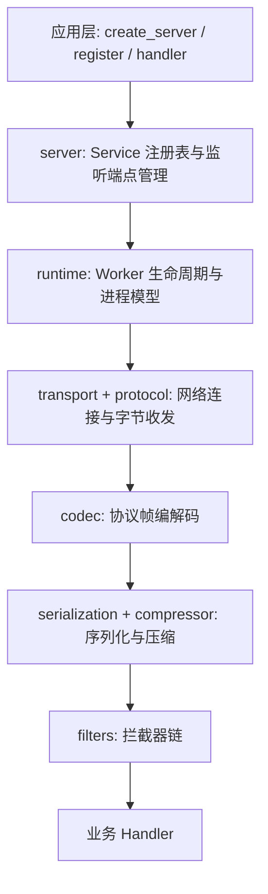
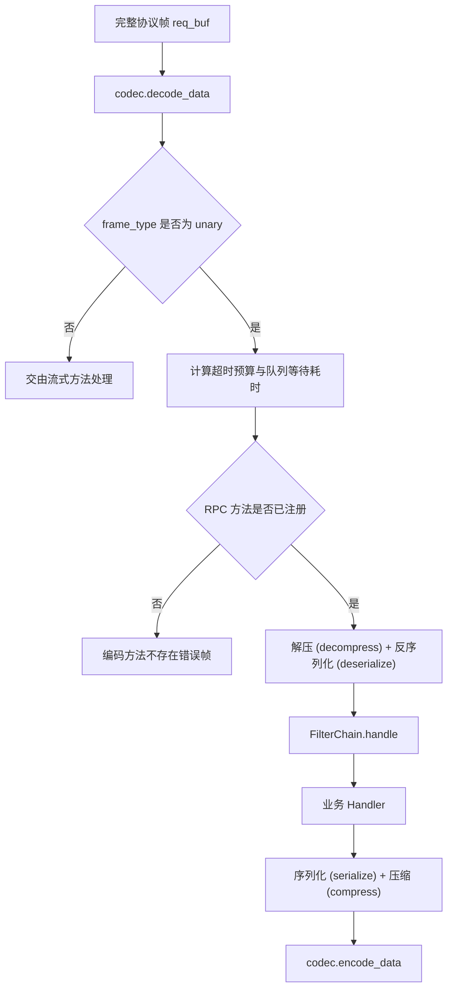
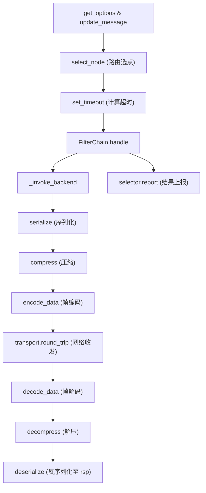
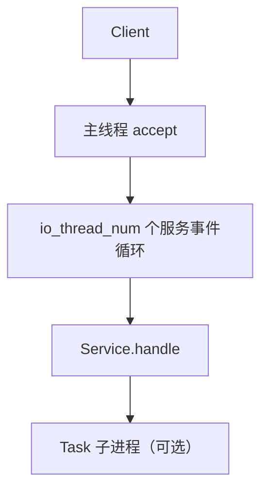
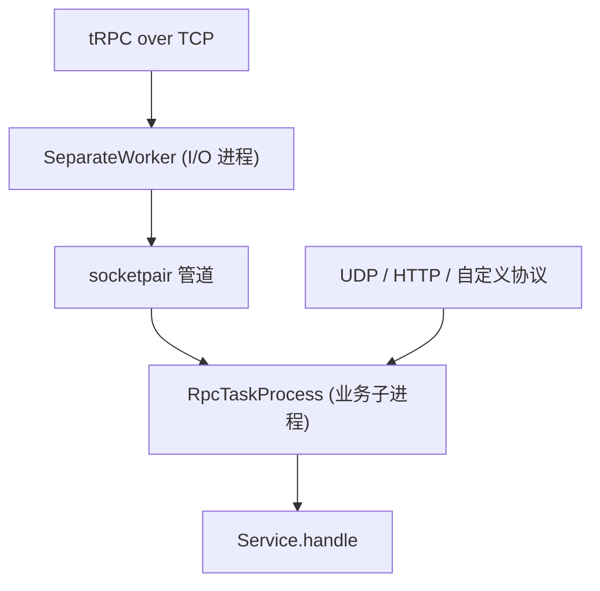
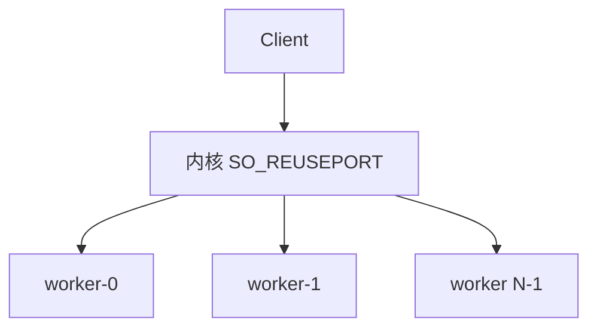
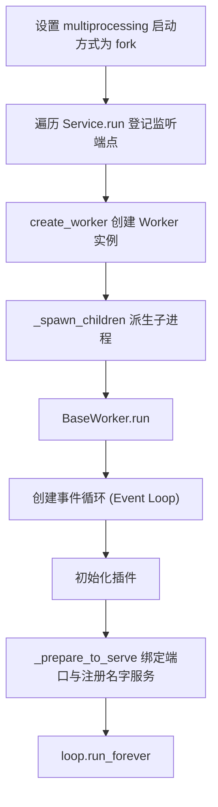

# tRPC-Python 架构设计

本文介绍 tRPC-Python 框架的整体分层、一元 RPC 调用的完整执行链路，以及进程与线程模型的职责划分。通过本文，你可以了解一个请求在框架内部流经哪些模块、运行在哪个进程，以及各个插件扩展点（Slot）挂载在调用链路的哪个阶段。

关于插件注册机制、拦截器（Filter）编写及协议四件套的接入方式，请分别参考 [插件开发基础](develop_plugins/plugin.zh_CN.md)、[过滤器插件](develop_plugins/filter.zh_CN.md) 和 [协议插件](develop_plugins/protocol.zh_CN.md)。本文重点说明这些扩展点在调用链路中的位置与协作关系。

## 整体分层

业务应用代码主要完成三件事：通过 `create_server` 读取 YAML 配置并构建 `Server` 实例；通过生成的桩代码 `register` 将 RPC 方法注册到各个 `Service`；编写业务处理函数（Handler）处理反序列化后的请求对象。调用 `Server.serve()` 后，进程生命周期交由 `runtime` 模块接管。

各核心职责划分如下：

- **[`trpc_sdk.server`](../../trpc_sdk/server/__init__.py)**：维护 `service_name -> Service` 映射表。`TrpcServerAdapter` 仅负责将监听地址、Handler、分包器（Checker）和超时配置登记到内部表中，自身不执行端口监听，也不创建子进程（`fork`）。
- **[`trpc_sdk.runtime`](../../trpc_sdk/runtime/__init__.py)**：`BaseWorker` 定义了所有服务进程共用的生命周期模板。框架根据 `ServerOption.mode`（由 `global.processmodel` 解析而来）选择具体的 Worker 实现：
  - `merge` 模式使用 `MergeWorker`（当 `io_handle_type: separate` 时使用其子类 `SeparateThreadWorker`）；
  - `separate` 模式使用 `SeparateWorker`；

网络字节流处理与协议帧解析解耦为三个层次：

- **`transport`（传输层）**：负责底层字节收发。客户端侧管理连接池并执行单次 `round_trip`；服务端侧在 `bind` 阶段记录监听参数，在 `fork` 之后调用 `listen` 启动监听，由 `runtime` 遍历各 transport，按其是否为 user 协议、`ipc_forwardable` 是否为 True，决定每个地址由哪个进程、哪个事件循环监听。
- **`protocol`（连接协议层）**：`protocol.TCPConnection` 挂载在本进程已 `accept` 的 TCP 套接字上，调用 `checker` 进行切帧，并将响应写回同一条连接。`ConnWriter` 封装了跨线程写回能力，允许其他线程安全地向该连接写入数据。
- **`codec`（编解码层）**：负责单个协议帧内的帧头与包体（Body）解析。`checker` 仅负责从字节流中切出完整的帧边界，不解析业务协议体。

此外，横切关注点相关的模块不在上述主箭头上，调用链路在运行时按名称从插件注册表中获取实例：`plugin` 提供全局注册表，`filters`、`serialization`、`compressor`、`naming`、`config` 均通过该注册表存取插件实例。

## 服务端一元请求链路

在 TCP 连接上，每条连接持有独立的 `checker` 实例。当 `data_received` 收到新字节时，先交由 `feed_data` 写入缓冲区，再通过 `read` 提取已接收完整的帧。只有当切出完整的一帧（`req_buf`）后，才会进入 `Service.handle`。

`Service.handle` 的处理流程如下：

各阶段细节说明：

1. **帧解码与分流**：`decode_data` 从帧中提取帧头和协议头写入当前调用的 `TrpcMessage`，并返回包体字节。若帧类型不是 `unary`（一元调用），则在超时检查前分流至已注册的流式方法处理。
2. **排队与超时检查**：仅一元请求会执行队列等待检查与超时预算合并。若开启了 `check_timeout` 且请求在队列中等待超时，框架会直接编码超时错误响应并返回。
3. **查找方法与反序列化**：从 `message.get_server_rpc_name()` 获取目标方法名。匹配到 `Method` 后，调用 `req_cls()` 创建空的请求对象，依次按 `message.compress_type` 解压、按 `message.serialization_type` 反序列化填充到该对象中。因此，拦截器（Filter）拿到的 `req` 已经是反序列化后的业务请求对象。
4. **拦截器链与业务处理**：`FilterChain.handle` 包裹业务处理函数执行。YAML 配置 `filter` 列表中排在前面的拦截器位于最外层（其前置逻辑最先执行，后置逻辑最后执行）。拦截器链返回 `(rsp, error)`；若无错误，框架将响应对象依次序列化、压缩，并调用 `encode_data` 打包为响应帧。
5. **异常处理**：`TrpcException` 及其他未捕获异常都会被编码为带错误码的响应帧（包体为空），异常影响范围被隔离在当前请求内，Worker 进程继续正常服务后续请求。
6. **HTTP 协议分支**：HTTP 请求走 `Service.handle_http`。由于 `aiohttp` 已将请求对象挂载到上下文中，该路径会跳过解压与 Protobuf 反序列化步骤，但仍会进入同一条拦截器链；其返回值为拦截器链的处理结果，而非 tRPC 二进制帧。

## 客户端一元调用链路

客户端调用与服务端复用相同种类的扩展槽位，但数据处理方向相反。每次调用 `Client.invoke` 时，框架会新建一份 `Options`，将主调元数据、序列化类型、压缩类型写入 `TrpcMessage`，随后先执行路由选点（选点位于拦截器链外围）。

各阶段细节说明：

1. **路由选点与上报**：当 `target` 配置为 `scheme://endpoint` 格式时，`scheme` 即为 `NAMING_SELECTOR` 插件的注册名。`select_node` 通过 `get_selector` 获取对应插件并调用 `select`，将选中的目标地址写回 `message`。调用结束时，无论成功或抛出异常，`finally` 块中都会调用 `selector.report` 上报调用结果与耗时。
2. **内层收发（`_invoke_backend`）**：位于拦截器链最内层。先按 `message` 上指定的类型对请求对象进行序列化和压缩，调用 `encode_data` 生成完整请求帧，再交由 `transport.round_trip` 发送。客户端 `checker` 在读取响应阶段工作，`read_frame` 从连接池的连接中读取完整的一帧；随后依次执行 `decode_data`、解压，并反序列化到调用方预先构造的 `rsp` 对象中。
3. **协议组件绑定**：服务端的 `service.protocol` 与客户端的 `set_protocol` 均使用同一个协议名字符串，同时查找对应的 `codec`、`checker` 以及可选的 `transport`。若客户端未找到同名的自定义 `transport`，则保留默认的 `trpc` 传输层实现。

## 调用上下文与消息对象

每次 RPC 调用都携带一个 `TrpcContext` 实例，其内部挂载了一份 `TrpcMessage`（服务端可通过 `get_message(ctx)` 获取，客户端可通过 `ctx.get_message()` 获取）。编解码器、拦截器、超时控制与路由选点均通过读写这份 `TrpcMessage` 进行协作。

### `TrpcContext` 常用属性与方法

业务代码可直接访问的上下文属性包括：
- `deadline` 与 `timeout`：可通过 `get_timeout_ms()` 获取毫秒级超时时间（`<= 0` 表示不设限制）。
- `remote_ip` / `remote_port`、`local_ip` / `local_port`、`recv_time`：对端与本端网络地址及请求接收时间戳。
- `with_meta_data`、`get_meta_data`、`pop_meta_data`：读写 `context` 自身的本地字典 `meta_data`，**仅在当前进程内可见**，不会随网络发送。若需跨进程透传键值对，请使用 `message` 上的 `client_meta_data` / `server_meta_data`（由 `codec` 写入协议帧头 `trans_info`，详见 [链路透传](../user_guide/metadata_transmission.zh_CN.md)）。

### `TrpcMessage` 核心架构字段

- `server_rpc_name`：服务端据此查找已注册的 RPC 方法。
- `serialization_type`、`compress_type`：整型枚举值，分别对应 `SERIALIZATION` 和 `COMPRESS` 插件的注册名（由外层框架代码按编号查找插件，`codec` 自身不查表）。
- 主调元数据、对端地址、剩余超时：由选点逻辑和超时控制模块写入，随协议帧发送至对端。
- `server_rsp_err`、`client_rsp_err`：记录业务或框架错误。服务端据此编码错误响应帧；客户端在拦截器链返回后若检测到失败错误码，会将其重新抛出为异常。

### 超时预算计算时机

超时计算在服务端和客户端各有一处，均发生在进入拦截器链之前：
- **服务端**：在进入拦截器链前合并本服务超时与上游传入超时，并将请求在队列中的等待时间计入消耗。
- **客户端**：在进入拦截器链前调用 `set_timeout`，取客户端配置的超时时间与上游剩余截止时间（`deadline`）中更紧迫的一个，并将剩余可用时间写入即将发出的 `message`。

## 进程与线程模型

执行 `python trpc_main.py` 启动的初始进程即为根 Worker 进程。`serve()` 根据 `global.processmodel` 配置选择对应的 Worker 类接管进程。该 Worker 负责 `fork` 出子进程并进行监控，而根进程自身由 `systemd`、Kubernetes 等外部进程管理器拉起与守护。

> **为什么必须在创建事件循环前 `fork`？**
> 事件循环底层持有的 `epoll` 或 `kqueue` 文件描述符不能跨 `fork` 共享，且进程间通信管道（`socketpair`）需要在首次 `fork` 前创建完毕以便子进程继承。因此，`serve()` 在入口处会将 `multiprocessing` 的启动方式强制设为 `fork`，并在父进程尚未创建事件循环时完成所有子进程的派生。

框架支持三种运行模式，由 `global.processmodel` 决定（默认为 `merge`）：
- `mode: single_process` + `io_handle_type: merge`；
- `mode: single_process` + `io_handle_type: separate`；
- `mode: multi_process` + `io_handle_type: separate` 对应 **`separate` 模式**；
- `mode: multi_process` + `io_handle_type: merge`。

### 1. 单进程模式

单个进程同时负责 `accept` 连接与执行业务 Handler，请求处理不跨进程。

- **单线程 / 多线程合并（`io_handle_type: merge`）**：默认仅启动 1 个事件循环，`accept` 和业务 Handler 均在该循环上运行。当 `io_thread_num`（对应 YAML 中的 `io_num`，需与 `handle_num` 一致）大于 1 时，主线程负责 `accept`，并将新连接轮询分配给各个服务线程的事件循环；为 1 时则不额外创建线程。UDP 套接字由每个服务循环通过 `SO_REUSEPORT` 独立绑定同一地址；自定义协议与定时器固定运行在 0 号服务线程上。
  - 注意：同一进程内的多个线程共享同一个 GIL。网络 I/O 等待以及会释放 GIL 的 C 扩展可以并发重叠，但纯 Python 的 CPU 密集型计算无法通过多线程利用多核（此类场景建议使用多进程 `separate` 模式）。
- **单进程 I/O 与业务线程分离（`io_handle_type: separate`）**：仍在单个进程内运行，但将线程拆分为两组，底层实现类为 `SeparateThreadWorker`：
  - `io_num` 个 **I/O 线程**：仅负责网络读写、切帧和写回响应，不执行业务逻辑（主线程额外负责 `accept`、信号处理和心跳检查）。
  - `handle_num` 个 **Handle 线程**：负责运行业务 Handler、拦截器、定时器和 HTTP 服务。
  - 一元请求由 I/O 线程投递至 `SharedHandlerPool`，处理完毕后通过该连接的 `ConnWriter` 写回响应。同一条连接上的多个一元请求可能被分配到不同的 Handle 线程，完成顺序不做保证（tRPC 协议通过请求 ID 匹配响应）；流式调用的所有帧则按 `(session_id + stream_id) % handle_thread_num` 固定路由到同一个 Handle 线程。

> 注意区分：`single_process` + `io_handle_type: separate`（单进程多线程分离）与下文 `multi_process` + `io_handle_type: separate`（多进程分离）是两套机制——前者不跨进程，后者会 `fork` 出独立的业务子进程。

### 2. 多进程模式（I/O 与 Handle 分离）

由 `SeparateWorker` 独占对外的 TCP 监听端口，负责 `accept` 连接与协议切帧，再通过 `socketpair` 管道将完整帧转发给 `worker_num` 个 `RpcTaskProcess` 子进程。业务 Handler、编解码器（Codec）和拦截器均在子进程中运行。`worker_num` 取自 `global.processmodel.handle_num`（为 `0` 或未配置时默认等于 CPU 核心数）。这种模式让各个业务子进程拥有独立的 GIL，代价是每次请求增加一次进程间管道拷贝。

- **内部通信协议**：I/O 进程侧使用 `SeparateClientConnection`（接收客户端数据、切帧并写入管道）、`SeparateRpcTaskConnection`（从管道读取子进程响应并写回客户端）和 `SeparateRpczConnection`；业务子进程侧对端为 `RpcTaskConnection`（均定义在 `trpc_sdk/transport/_separate.py`）。转发帧头的 `port` 字段携带的是监听地址下标，因此即使两个服务共用同一端口也能准确找到对应的 Handler；响应则按 `(fd, session_id)` 路由回对应的客户端连接。一元请求采用轮询（Round-Robin）分发，流式请求按 `(session_id + stream_id) % worker_num` 粘滞到同一个业务子进程。
- **非 TCP 协议处理**：只有 `ipc_forwardable` 为 True 的 tRPC TCP 端点才会经过 I/O 进程转发。UDP、HTTP 以及通过 `register_protocol_handle` 注册的自定义协议，均由每个 `RpcTaskProcess` 子进程使用 `SO_REUSEPORT` 自行绑定监听，由操作系统内核分发连接（注：macOS 下 `SO_REUSEPORT` 不会在多进程间均衡分发连接，流量会落在其中一个子进程上）。
- **插件与就绪顺序**：I/O 进程仅执行 `init_task_plugins()`，不加载业务插件，也不运行定时器；`RpcTaskProcess` 子进程加载全部插件并运行定时器。子进程先连接管道、执行启动钩子、绑定自身监听地址，再置位就绪标志；待所有子进程就绪后，I/O 进程才绑定对外 TCP 端口并执行名字服务注册。

### 3. 多进程模式（I/O 与 Handle 合并）

`PeerMainWorker` 作为 `worker-0`，负责 `fork` 出 `worker_num - 1` 个对等子进程。包括 `worker-0` 在内的所有 Worker 进程各自使用 `SO_REUSEPORT` 绑定全部监听地址，进程内部按单事件循环的 `merge` 模式处理请求。进程之间不转发数据，完全由操作系统内核分摊连接（`worker_num` 取自 `global.processmodel.handle_num`，为 `0` 时取 CPU 核心数）。

> **限制说明**：此模式不支持挂载 Task 子进程。若在 `serve()` 前调用了 `register_task`，启动时会直接抛出 `ValueError`。此外，macOS 下 `SO_REUSEPORT` 不会将连接均摊到多个 Worker，每个地址实际上仅由其中一个 Worker 提供服务。

### 4. Task 子进程与定时器

- **Task 子进程**：用于将阻塞型或批处理计算移出服务事件循环。Worker 在创建事件循环前预先建立好 `socketpair` 网格并 `fork` 出 Task 子进程。业务在 Handler 中调用 `send_to_task` 时，请求经编码后写入对应 Task 的管道，并通过 `Future` 异步等待子进程返回结果；Task 子进程内部由消费线程按批次调用用户注册的处理函数（详见 [任务插件](develop_plugins/task.zh_CN.md)）。
- **定时器（`TimerExecutor`）**：在完成端口绑定后启动。`merge` 模式下每个服务进程启动一个定时器执行器；`separate` 模式下仅在 `RpcTaskProcess` 业务子进程中启动，I/O 进程会跳过该步骤，避免同一通用定时任务被重复执行。
- **子进程健康监控**：Worker 与其派生的子进程之间维护有心跳管道。一旦检测到子进程异常退出，父 Worker 会以状态码 `1` 退出，以便外部进程管理器（如 systemd / K8s）感知故障并重启整个进程树（配置项 `server.reboot_child` 当前固定按关闭处理，不会在进程内单独拉起崩溃的子进程）。

## 启动与退出流程

调用 `create_server(conf_path)` 时，框架执行 `TrpcConfig.load` 解析配置文件，并为 `server.service[]` 中的每一项构建 `Service` 实例（挂载对应协议的 `transport`、`codec`、`checker` 和拦截器列表）。**这一步仅在内存中组装对象，不绑定端口、不 `fork` 进程，也不向名字服务注册。** 随后桩代码调用 `Server.register`，将 `ServiceDesc` 方法表注册到各个已创建的 `Service` 上。

### 启动流程（`serve()`）

1. `create_worker` 创建 Worker 并挂载生命周期回调，随后在尚未创建事件循环、也未启动名字服务注册线程的状态下完成 `_spawn_children`（`fork` 子进程）。
2. 每个服务进程进入 `BaseWorker.run`：先标记当前进程角色，必要时等待 Task 子进程就绪，然后创建事件循环并初始化插件，最后调用 `_prepare_to_serve`。
3. 在 `_prepare_to_serve` 中：连接属于当前进程的 Task 管道 → 调用 `start_worker_process` 绑定监听端口（或连接 `RpcTaskProcess` 管道）→ 执行 `ready_callbacks`（此时监听端口已就绪可访问，名字服务注册在此阶段触发）→ 启动定时器。

### 优雅退出流程

收到退出信号后，各服务进程按以下统一模板依次执行收尾：

1. **执行 `exit_callbacks`**：调用 `Server._shutdown_services` 向名字服务发起反注册（摘除节点），并将 `Server` 标记为关闭状态。
2. **停止接收新连接**：关闭监听套接字，停止 `accept`。
3. **连接排空等待（`close_wait_time`）**：等待配置的排空时间（YAML 配置单位为毫秒，Worker 内部转换为秒）。在此期间，事件循环继续运行，确保已接收并正在处理的请求能够写完响应。
4. **执行 `post_drain_callbacks`**：调用 `TrpcServerAdapter.close`，等待名字服务反注册完成。
5. **等待子进程结束**：若当前进程需要等待其他业务子进程处理完毕（例如 `separate` 模式下的 I/O 进程等待所有 `RpcTaskProcess` 退出），在此阶段阻塞等待。
6. **执行退出回调**：依次执行 `master_exit_callbacks` 及 Worker 自身的退出回调。

> 退出流程中的单个回调若抛出异常，框架仅记录错误日志，不会中断后续清理步骤的执行。

## 插件在架构中的挂载位置

插件在定义它的 Python 模块被 `import` 时，通过装饰器注册到全局插件表中（仅执行 `import trpc_sdk` 不会自动导入业务自定义插件）。框架在运行时按插件类型（`PluginType`）和注册名调用 `get_plugin` 获取实例，**不会**自动遍历 YAML 顶层的 `plugins:` 字典去实例化对象；`plugins:` 段作为一个整体字典保留，由各插件自身调用 `get_plugins_config()` 读取（详见 [插件开发基础](develop_plugins/plugin.zh_CN.md)）。

在进程初始化阶段：
- 实际处理 RPC 请求的 Worker 进程在 `BaseWorker.run`（绑定端口前）调用 `init_worker_plugins()`，初始化全部已注册插件。
- `separate` 模式的 I/O 进程以及 Task 子进程则调用 `init_task_plugins()`，该过程会跳过 `USER_DEFINED` 类型的业务插件。

下表汇总了请求处理路径上涉及的各类插件槽位。其中前六项（Codec、Checker、Transport）在构建 `Service` 或客户端 `Options` 时查找并绑定一次；序列化、压缩和路由选点（Selector）则在每次调用时根据 `message` 或 `target` 动态查表：

| 扩展能力 | `PluginType` | 查找函数 | 挂载与执行时机 |
| --- | --- | --- | --- |
| 服务端编解码 | `SERVER_CODEC` | `get_server_codec` | `ServiceOption.set_protocol` 时绑定；在 `Service.handle` 中调用 `decode_data` / `encode_data` |
| 客户端编解码 | `CLIENT_CODEC` | `get_client_codec` | `Options.set_protocol` 时绑定；在 `_invoke_backend` 中进行请求编码与响应解码 |
| 服务端分包器 | `SERVER_CHECKER` | `get_server_parser` | `set_protocol` 时绑定工厂；每条 TCP 连接建立时调用 `create()`，在进入 `codec` 前通过 `feed_data` / `read` 切出完整帧 |
| 客户端分包器 | `CLIENT_CHECKER` | `get_client_parser` | `set_protocol` 时绑定；在 `round_trip` 读取响应时通过 `read_frame` 切帧 |
| 服务端传输层 | `SERVER_TRANSPORT` | `get_server_transport` | `create_server` 按 `service.protocol` 查找；未注册同名插件时回退至基础的 `TrpcServerTransport` |
| 客户端传输层 | `CLIENT_TRANSPORT` | `get_client_transport` | `set_protocol` 时查找，仅在找到同名插件时替换默认的 `trpc` 传输层 |
| 服务端拦截器 | `SERVER_FILTER_COMPONENT` | `get_server_filter` | 创建 `Service` 时按 `server.filter` 挂载；在 `Service.handle` 完成反序列化后进入拦截器链 |
| 客户端拦截器 | `CLIENT_FILTER_COMPONENT` | `get_client_filter` | 构建客户端 `Options` 时挂载；在 `Client.invoke` 完成选点后进入拦截器链（链内执行序列化与网络传输） |
| 序列化 | `SERIALIZATION` | `get_serializer` | 注册名为 `ContentType` 整数枚举。服务端在进出拦截器链前后分别反序列化和序列化；客户端在 `_invoke_backend` 内执行 |
| 压缩 | `COMPRESS` | `get_compress` | 注册名为 `ContentEncoding` 整数枚举。解压在反序列化之前执行，压缩在序列化之后执行 |
| 路由选点 | `NAMING_SELECTOR` | `get_selector` | 在客户端拦截器链外围的 `select_node` 阶段执行，`target` 的 `scheme` 即为插件注册名 |
| 服务注册 | `NAMING_REGISTRY` | 注册中心插件 | 在端口监听成功后的 `ready_callbacks` 中由 `start_service_registry` 触发 |
| 业务配置加载 | `CONFIG_PROVIDER`、`CONFIG_DECODER` | `ConfigLoader` | 供业务代码主动加载外部配置使用（框架启动读取 `trpc_python.yaml` 固定使用内置的 `file` 和 `yaml`） |
| 日志 | `LOG`、`LOG_WRITER` | 启动时按 `plugins.log` 初始化 | 独立于单次 RPC 编解码路径之外 |
| 异步任务 | `TASK` | `register_task` | 插件规格（Spec）的 `cls` 为空，`get_plugin` 不返回实例；业务在 Handler 中通过 `send_to_task` 发起调用 |

补充说明：
- 名字服务中的子插件（`discovery`、`loadbalance`、`circuitbreaker`、`servicerouter`）仅在客户端未配置 `target`、走默认 `TrpcSelector` 组合链时参与选点；一旦配置了 `scheme://endpoint` 格式的 `target`，当次调用将直接使用对应 `scheme` 的 `Selector` 插件（详见 [名字服务插件](develop_plugins/naming.zh_CN.md)）。
- 此外，`PluginType` 还定义了 `METRICS`、`TRACE`、`ADMIN` 枚举（监控与日志扩展写法见对应插件开发文档；导入 `trpc_sdk.admin` 时会自动注册名为 `admin` 的管理插件）。
