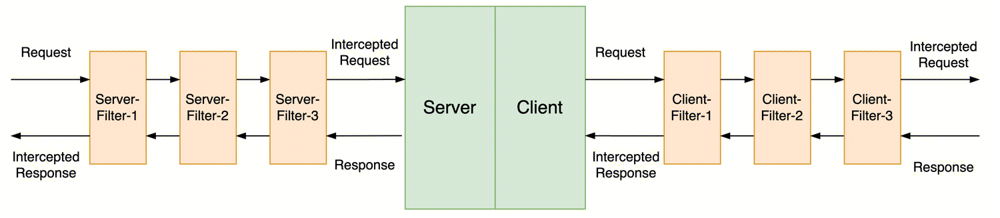

English | [中文](filter.zh_CN.md)

# How to Write a Filter Plugin

A filter wraps the business handling of one RPC. The server and the client use the same `BaseFilter`. They differ in the registration type and the yaml mount point.

The `req` a filter receives is the business object. It does not receive the raw bytes. A unary server has already decoded, decompressed, and deserialized before entering the chain. The client wraps serialization, encoding, transport, and decoding at the innermost part of the chain. How bytes enter the protocol header, and how they are restored to a business object, is in the [Protocol Plugin](protocol.md).

A plugin registers through `@register_plugin` at import time. Your own module must be imported from the service entry, or the decorator never runs.

## Execution Order



The request moves from left to right, and the response moves from right to left. The first item in the server `filter` list is Server-Filter-1. The last item is closest to the business handler. The client is the same: Client-Filter-1 is the first item of `client.filter`. The Server / Client boxes in the figure are business handling, not two machines.

## When the Framework Enters the Chain

A server unary call enters the chain in `Service.handle`. After decode, decompress, and deserialize, it calls `filters.handle(ctx, req, handler.impl_func, timeout)`. An HTTP route goes through `handle_http` and calls the same chain. Protobuf deserialization is skipped in the middle, and `req` is the HTTP request already placed on the context.

A client unary call enters the chain in `Client.invoke`. Node selection is outside the chain: only after `select_node` finishes does it call `opts.filters.handle(ctx, req, partial(_invoke_backend, ...))`. The chain includes serialization, encoding, transport, and decoding.

`FilterChain.handle` first wraps the business coroutine as `_call_handle`, then wraps each `filter.run` in `reversed(self.filters)`. A filter earlier in the list sits on the outside: its pre-logic runs first, and its post-logic runs last. The order is the figure in the previous section.

Note:

- The business `func(ctx, req)` returns only the response object.
- Each filter's `run` returns `(rsp, error)`, of type `FilterReturnType`.
- `next_handle` takes no arguments. To continue, write `rsp, err = await next_handle()`.

`_call_handle` catches exceptions raised by the business function, so a filter's `await next_handle()` can see `err`:

- A `TrpcException` becomes `(None, err)`, and `err` is that exception.
- Timeout or cancellation: the server uses `ServerTimeoutError`, and the client uses `ClientTimeoutError`.

An exception raised by the filter itself does not go through the conversion above. It is thrown to the server `Service.handle` or the client `invoke`. The server encodes it as an error response. The client reports the selection result and then raises it again.

## Implementing a Filter

The base class is `BaseFilter`, which inherits `BasePlugin`. Keys of `server_meta_data` are `str`, and values are `bytes`, matching `map<string, bytes>` of `trans_info` in the protocol.

```python
from trpc_sdk.abc import BaseFilter
from trpc_sdk.abc import FilterReturnType
from trpc_sdk.abc import PluginType
from trpc_sdk.abc import TrpcContext
from trpc_sdk.abc import get_message
from trpc_sdk.exceptions import UnknownError
from trpc_sdk.plugin import register_plugin


@register_plugin(PluginType.SERVER_FILTER_COMPONENT, "auth")
class AuthServerFilter(BaseFilter):
    """Reject a request before the handler runs."""

    async def run(self, ctx: TrpcContext, req, next_handle) -> FilterReturnType:
        message = get_message(ctx)
        token = message.server_meta_data.get("token")
        if token != b"ok":
            return None, UnknownError("denied")
        rsp, err = await next_handle()
        return rsp, err

    async def run_stream(self, ctx, req, next_handle):
        raise NotImplementedError("AuthServerFilter does not wrap async-generator handlers")
```

A client filter is the same class, with the registration type changed to `PluginType.CLIENT_FILTER_COMPONENT`. What `Options.set_metadata` writes is also a `str` key and a `bytes` value, already merged into `message.client_meta_data` before the chain. To read a field this call is carrying out, do it before `await next_handle()`. After the return, decoding overwrites `client_meta_data` with `trans_info` from the downstream response.

The filter below takes a timestamp before and after the call, then returns `(rsp, err)` unchanged.

```python
import time

from trpc_sdk.abc import BaseFilter
from trpc_sdk.abc import FilterReturnType
from trpc_sdk.abc import PluginType
from trpc_sdk.abc import TrpcContext
from trpc_sdk.log import logger
from trpc_sdk.plugin import register_plugin


@register_plugin(PluginType.CLIENT_FILTER_COMPONENT, "timing")
class TimingClientFilter(BaseFilter):
    """Record elapsed time around one outbound call."""

    async def run(self, ctx: TrpcContext, req, next_handle) -> FilterReturnType:
        start = time.monotonic()
        rsp, err = await next_handle()
        logger.info("client call took %.3f s", time.monotonic() - start)
        return rsp, err

    async def run_stream(self, ctx, req, next_handle):
        raise NotImplementedError("TimingClientFilter does not wrap async-generator handlers")
```

- Used only for this request, and not sent on the wire: `ctx.with_meta_data(key, value)`, `get_meta_data`, and `pop_meta_data`. `rpcz` puts the span here.
- Metadata that travels with the RPC: `server_meta_data` and `client_meta_data` after `get_message(ctx)`.

## Configure in YAML

The yaml key is `filter`. The parsed Python field is called `filters`. Values are registered names, not class names.

### Server

`create_server` installs `server.filter` first, then appends `server.service[].filter` after it. The result is then deduplicated, keeping each filter at its first position: a name listed at both levels takes its position in `server.filter`, and a name repeated within one list is installed once.

When a name cannot be found, `get_server_filter` returns `None`, `_add_server_filters` raises `PluginInitError`, and the service does not start.

```yaml
server:
  filter:
    - auth
    - audit
  service:
    - name: trpc.app.server.Greeter
      protocol: trpc
      network: tcp
      filter:
        - audit_service
      enable_stream_filter: false
```

The request order of this chain is `auth` → `audit` → `audit_service` → business, and the return order is the reverse. `auth` is the outermost filter, corresponding to Server-Filter-1 in the figure.

### Client

- When a backend does not write `filter`, the field stays `None`, and the whole client-level list is used.
- When both sides are lists, they are ordered with the client level first and that backend after it. They are not deduplicated. The same name enters the chain twice.
- A backend that does not appear in `client.service` uses this client-level `filter`.

`load_client_config` calls `get_client_filter` for each name, then `add_filter`. `add_filter` skips an empty object. When an unregistered name is written, that link is missing from the chain. Startup does not raise `PluginInitError`.

```yaml
client:
  filter:
    - auth
  service:
    - name: trpc.app.server.Greeter
      filter:
        - audit
      enable_stream_filter: false
```

The request order of this chain is `auth` → `audit` → the backend call, and the return order is the reverse. `auth` is the outermost filter, corresponding to Client-Filter-1 in the figure.

In code you can also use `Options.set_filter` and `set_filter_list`. They run after yaml is read and append to the tail of the chain by default. With `override=True`, they replace the chain with the list passed this time.
