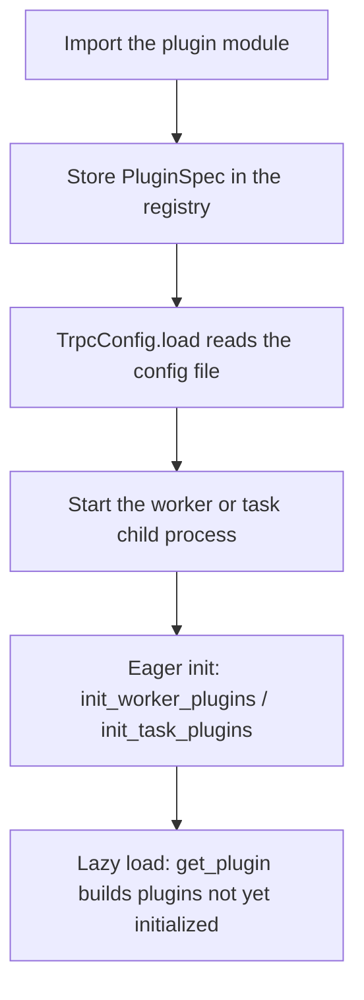

English | [中文](plugin.zh_CN.md)

# How to Write a Plugin

How the framework is layered, and which extension slots one RPC passes through, is in [Architecture](../architecture.md). This page covers how a plugin is registered, how its lifecycle runs, and how it reads configuration.

In tRPC-Python, a plugin is a type, or a factory function, entered in the framework registry when its module is imported. Two rules matter:

1. **An explicit import is what registers it.** `import trpc_sdk` does not register your plugin. `@register_plugin` runs only when the module that defines the plugin is imported. The service entry must import that module before `create_server` or the first `get_plugin`.
2. **Configuration and instantiation are separate.** `trpc_python.yaml` has two kinds of configuration:
   - Typed framework fields, such as `server.filter` and `service.protocol`, are read by the framework, which then looks up a registered plugin by name.
   - The top-level `plugins:` node, except `plugins.log`, is kept as a dict. **The framework does not instantiate a plugin because a key appears under `plugins:`.** The plugin reads what it needs by calling `get_plugins_config()` inside `init()`.

Imports you will use:

- **Base classes and enums** (`trpc_sdk.abc`): `PluginType`, `PluginInitPos`, `BasePlugin`, `BasePluginFactory`.
- **Registration and lookup** (`trpc_sdk.plugin`): `register_plugin`, `get_plugin`, `get_plugin_class`, `init_worker_plugins`, `init_task_plugins`, `set_plugin_order`.

## 1. Register a Plugin

Register with the `register_plugin` decorator:

```python
register_plugin(
    plugin_type: PluginType,
    plugin_name: str,
    init_pos: PluginInitPos = PluginInitPos.WORKER,
    version: str = "",
    report: bool = False,
)
```

- **What you decorate** only needs to be callable with no arguments. The usual case is a subclass of `BasePlugin`. It can also be a function that returns a factory instance, which is how a protocol checker is registered, or a Cython extension type.
- **Instantiation is deferred.** When the decorator runs, it only stores a `PluginSpec` in the registry. No plugin instance exists yet.
- **A later registration replaces an earlier one.** Registering the same `PluginType` and `plugin_name` again overwrites the previous spec. The framework does not report an error.
- **Task plugins are the exception.** A batch-task process is registered with `register_task`, not this decorator. See [Task Plugin](task.md).

### A Business Plugin (`USER_DEFINED`)

`PluginType.USER_DEFINED` (value `1000`) is reserved for a business's own plugins. The framework never calls a plugin of this type on its own. Business code fetches the instance with `get_plugin` when it needs it:

```python
from trpc_sdk.abc import BasePlugin
from trpc_sdk.abc import PluginType
from trpc_sdk.plugin import register_plugin


@register_plugin(PluginType.USER_DEFINED, "business")
class BusinessPlugin(BasePlugin):
    """Business-owned plugin with no framework callback."""

    def init(self) -> None:
        return
```

Fetch that singleton from business code:

```python
from trpc_sdk.abc import PluginType
from trpc_sdk.plugin import get_plugin

plugin = get_plugin(PluginType.USER_DEFINED, "business")
```

## 2. Plugin Lifecycle

From importing the module to building an instance, the order is:



### Lifecycle Hooks

`BasePlugin` provides `init()`, `start()`, and `stop()`. All three are empty by default:

1. **`init()`** reads configuration and opens external connections. To abort process startup when initialization fails, raise `PluginInitError` from `init()`. Import it from `trpc_sdk.plugin`.
2. **`start()`** runs immediately after `init()` returns. If the instance did not set `name`, `type`, or `init_pos` itself, the plugin manager fills those fields from the registration spec before calling `start()`.
3. **`stop()`** stays on the base class. Neither eager initialization nor the lazy load in `get_plugin` calls it. A plugin usually does not implement it.

### When Initialization Runs (`PluginInitPos`) and How Errors Are Handled

A worker that handles RPC calls runs `_init_plugins()` first inside `BaseWorker.run`, then `_prepare_to_serve()`. The default `_init_plugins()` is `init_worker_plugins()`. The `init_pos` passed at registration decides which eager pass builds the plugin:

- **`PluginInitPos.WORKER` (default).** `init_worker_plugins()` builds the instance and runs `init()` / `start()` when the worker process starts. Most plugins keep this default.
- **`PluginInitPos.TASK`.** `init_task_plugins()` initializes it when a task child process or the dispatcher starts. `init_task_plugins()` skips `USER_DEFINED`. Use this mark only when a plugin that is not `USER_DEFINED` really must be initialized early in the task child process.
- **`PluginInitPos.UNKNOWN`.** It is not part of eager initialization. The first `get_plugin` builds the instance and runs `init()` / `start()`.
- **`PluginInitPos.TIMER`.** The enum value is reserved. The framework does not eagerly initialize it.

**Errors and order:**

- On the eager path, an exception other than **`PluginInitError`** is only logged. The framework then removes that `PluginSpec` from the registry, so a later `get_plugin` returns `None`, and the process still starts. To stop a process from starting in this state, raise `PluginInitError`.
- To change the initialization order of several plugins of one `PluginType`, call `set_plugin_order(plugin_type, name_list)`. Names that are not in `name_list` are initialized first. Names in the list follow, in the given order.

## 3. Reading the `plugins` Configuration

Under the top-level `plugins:` node of `trpc_python.yaml`, the only section the framework reads itself is `plugins.log`:

```yaml
plugins:
  log:
    default:
      - writer: console
        level: info
```

For a business plugin or another extension, `TrpcConfig.load` keeps the YAML `plugins` dict as-is. The plugin reads it inside its own `init()` by calling `get_plugins_config()`. When the file has no `plugins` node, the result is `None`:

```python
from trpc_sdk.abc import BasePlugin
from trpc_sdk.abc import PluginType
from trpc_sdk.config import get_plugins_config
from trpc_sdk.plugin import PluginInitError
from trpc_sdk.plugin import register_plugin


@register_plugin(PluginType.USER_DEFINED, "business")
class BusinessPlugin(BasePlugin):
    """Read a token from the plugins mapping."""

    def init(self) -> None:
        plugins = get_plugins_config() or {}
        cfg = plugins.get("business") or {}
        self.token = cfg.get("token", "")
        if not self.token:
            raise PluginInitError("business plugin requires plugins.business.token")
```

The matching YAML is below. The plugin chooses the key. Matching the registered plugin name makes the section easy to find:

```yaml
plugins:
  business:
    token: secret
```

The startup file `trpc_python.yaml` is always loaded with the built-in `file` data source and the `yaml` decoder. To load a separate configuration file of your own, use `ConfigLoader`. See [Config Plugin](config.md).

## 4. Plugin Factory (`BasePluginFactory`)

Most plugins are one singleton for the process. Some slots need a new object for each connection or listen socket:

- A **server protocol checker (`SERVER_CHECKER`)** keeps a receive buffer for one TCP connection, so each connection needs its own parser.
- A **server transport (`SERVER_TRANSPORT`)** is bound to one listen socket.

For those slots, the plugin subclasses `BasePluginFactory`. The plugin manager caches that factory as a singleton and runs `init` / `start` on it. Each caller then gets a new working object from `factory.create()`.

What you register is **a function that returns a factory instance**, not the factory class. This matches the built-in `setup_server_parser`:

```python
from trpc_sdk.abc import BasePluginFactory
from trpc_sdk.abc import PluginType
from trpc_sdk.plugin import register_plugin


class MyCheckerFactory(BasePluginFactory):
    """Hand out one parser per connection."""

    def create(self):
        return MyParser()


@register_plugin(PluginType.SERVER_CHECKER, "myproto")
def setup_checker() -> MyCheckerFactory:
    return MyCheckerFactory()
```

## 5. Index of Plugin Guides

The table lists each `PluginType` and the page that explains it:

| Area | Registration type (`PluginType`) | Notes |
| --- | --- | --- |
| **Filter** | `SERVER_FILTER_COMPONENT`<br>`CLIENT_FILTER_COMPONENT` | Intercept the request and response, and configure the `filter` chain and its order. See [Filter Plugin](filter.md). |
| **Protocol and transport** | `SERVER_CODEC`, `CLIENT_CODEC`<br>`SERVER_CHECKER`, `CLIENT_CHECKER`<br>`SERVER_TRANSPORT`, `CLIENT_TRANSPORT` | Custom framing, codec, and transport. See [Protocol Plugin](protocol.md) and [Database Plugin](database.md). |
| **Serialization and compression** | `SERIALIZATION`<br>`COMPRESS` | The registered name is the integer value of `SerializationType` or `CompressType`. See [Protocol Plugin](protocol.md). |
| **Config** | `CONFIG_PROVIDER`<br>`CONFIG_DECODER` | Extend the data source and decode format of business configuration. `PluginType.CONFIG` is only the internal base class. See [Config Plugin](config.md). |
| **Naming** | `NAMING_SELECTOR`, `NAMING_DISCOVERY`<br>`NAMING_LOADBALANCE`, `NAMING_CIRCUIT_BREAKER`<br>`NAMING_SERVICE_ROUTER` | Addressing, discovery, routing, load balancing, and circuit breaking. See [Naming Plugin](naming.md). |
| **Log** | `LOG_WRITER` (extend output)<br>`LOG` (built-in backend) | Register `LOG_WRITER` to extend a log sink. See [Log Plugin](log.md). |
| **Metrics** | `METRICS` | Connect to the `trpc_sdk.telemetry` reporting facade. See [Metrics Plugin](metrics.md). |
| **Batch task** | `TASK` | Use `register_task` and `send_to_task` to offload computation to a task child process. See [Task Plugin](task.md). |
