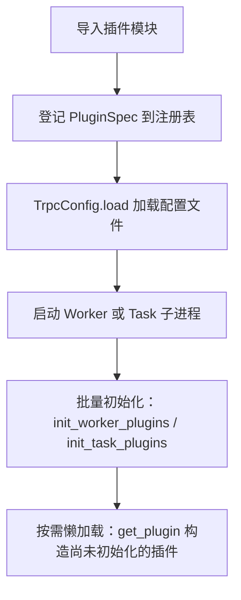

# 怎么开发一个插件

关于框架的整体分层以及单次 RPC 调用经过的扩展槽位，请先参考 [架构设计](../architecture.zh_CN.md)。本文重点介绍插件的**注册机制、生命周期与配置读取方式**。

在 tRPC-Python 中，插件是在模块被 `import` 时登记到框架注册表中的一个类型（或工厂函数）。需要注意两个核心原则：

1. **显式导入触发注册**：仅执行 `import trpc_sdk` 不会注册你的自定义插件。`@register_plugin` 装饰器只有在定义该插件的模块被导入时才会运行。因此，必须在服务启动入口处（调用 `create_server` 或首次调用 `get_plugin` 之前）显式 `import` 你的插件模块。
2. **配置与实例化解耦**：`trpc_python.yaml` 中的配置分为两类：
   - 框架结构化字段（如 `server.filter`、`service.protocol`）由框架自动读取并按名字查找已注册的插件。
   - 顶层的 `plugins:` 节点（除 `plugins.log` 外）会被原样保存为一个字典，**框架不会根据 `plugins:` 下的键名自动去实例化插件**，而是由插件自身在 `init()` 中调用 `get_plugins_config()` 按需读取。

常用导入路径：
- **抽象基类与枚举**（来自 `trpc_sdk.abc`）：`PluginType`、`PluginInitPos`、`BasePlugin`、`BasePluginFactory`。
- **注册与管理函数**（来自 `trpc_sdk.plugin`）：`register_plugin`、`get_plugin`、`get_plugin_class`、`init_worker_plugins`、`init_task_plugins`、`set_plugin_order`。

## 1. 注册插件

使用 `register_plugin` 装饰器登记插件，其函数签名如下：

```python
register_plugin(
    plugin_type: PluginType,
    plugin_name: str,
    init_pos: PluginInitPos = PluginInitPos.WORKER,
    version: str = "",
    report: bool = False,
)
```

- **被装饰对象**：只要是可以无参调用的对象即可。最常见的是继承自 `BasePlugin` 的类，也可以是返回工厂实例的函数（例如协议切帧器 checker），或者是 Cython 扩展类型。
- **延迟实例化**：装饰器执行时仅将一条 `PluginSpec` 元信息写入插件注册表，此时尚未创建插件实例。
- **同名覆盖**：如果同一 `PluginType` 和 `plugin_name` 被重复注册，后导入的定义会直接覆盖先前的定义，框架不会报错。
- **任务插件例外**：批处理任务进程使用专门的 `register_task` 函数登记，不使用此装饰器（详见 [任务插件](task.zh_CN.md)）。

### 自定义业务插件（`USER_DEFINED`）

枚举值 `PluginType.USER_DEFINED`（值为 `1000`）专门预留给业务自定义插件。框架内部不会主动调用该类型下的插件，业务代码可在需要时通过 `get_plugin` 获取其实例：

```python
from trpc_sdk.abc import BasePlugin
from trpc_sdk.abc import PluginType
from trpc_sdk.plugin import register_plugin


@register_plugin(PluginType.USER_DEFINED, "business")
class BusinessPlugin(BasePlugin):
    """Business-owned plugin with no framework callback."""

    def init(self) -> None:
        return
```

在业务代码中获取该插件单例：

```python
from trpc_sdk.abc import PluginType
from trpc_sdk.plugin import get_plugin

plugin = get_plugin(PluginType.USER_DEFINED, "business")
```

## 2. 插件生命周期

从导入模块到插件实例化，整体先后顺序如下：



### 生命周期钩子

`BasePlugin` 提供了 `init()`、`start()`、`stop()` 三个钩子方法（默认均为空实现）：

1. **`init()`**：用于读取配置、建立外部连接等初始化工作。如果希望初始化失败时直接中止进程启动，请在 `init()` 中抛出 `PluginInitError`（从 `trpc_sdk.plugin` 导入）。
2. **`start()`**：在 `init()` 成功返回后立即调用。若插件实例未自行设置 `name`、`type`、`init_pos` 属性，插件管理器会在调用 `start()` 前自动将注册时的元信息填充到实例上。
3. **`stop()`**：保留在基类上，目前批量初始化与 `get_plugin` 懒加载均不会调用它，编写插件时通常无需实现。

### 初始化时机（`PluginInitPos`）与异常处理

处理 RPC 请求的 Worker 进程在 `BaseWorker.run` 启动时，会先执行 `_init_plugins()`（默认即调用 `init_worker_plugins()`），再进入 `_prepare_to_serve()`。注册时的 `init_pos` 参数决定了插件在哪个阶段被批量初始化（eager initialization）：

- **`PluginInitPos.WORKER`（默认）**：在 Worker 进程启动时由 `init_worker_plugins()` 自动构造实例并执行 `init()` / `start()`。绝大多数插件保持该默认值即可。
- **`PluginInitPos.TASK`**：在任务子进程和 Dispatcher 进程启动时，由 `init_task_plugins()` 负责初始化。注意：`init_task_plugins()` 会跳过 `USER_DEFINED` 类型的插件；仅当非 `USER_DEFINED` 插件确实需要在任务子进程中提前初始化时才使用此标记。
- **`PluginInitPos.UNKNOWN`**：不参与启动时的批量初始化，直到首次调用 `get_plugin` 时才按需构造实例并执行 `init()` / `start()`。
- **`PluginInitPos.TIMER`**：仅保留枚举值，当前框架未对其执行批量初始化。

**异常处理与顺序控制**：
- 在批量初始化（eager）路径中，若插件抛出 **`PluginInitError` 以外的异常**，框架仅会打印错误日志，并将该插件的 `PluginSpec` 从注册表中移除（后续调用 `get_plugin` 也会返回 `None`），但进程会继续启动。若要阻止进程带病启动，请务必抛出 `PluginInitError`。
- 若需调整同一 `PluginType` 下多个插件的初始化顺序，可调用 `set_plugin_order(plugin_type, name_list)`：未出现在 `name_list` 中的插件会先初始化，出现在列表中的插件则按指定顺序排在后面依次初始化。

## 3. 读取 `plugins` 配置块

在 `trpc_python.yaml` 的顶层 `plugins:` 节点中，唯一由框架自动读取的是 `plugins.log`：

```yaml
plugins:
  log:
    default:
      - writer: console
        level: info
```

对于业务或其他扩展插件，`TrpcConfig.load` 会将 YAML 中的 `plugins` 字典原样保存，插件可在自身的 `init()` 方法中调用 `get_plugins_config()` 获取（若配置文件中没有 `plugins` 节点，则返回 `None`）：

```python
from trpc_sdk.abc import BasePlugin
from trpc_sdk.abc import PluginType
from trpc_sdk.config import get_plugins_config
from trpc_sdk.plugin import PluginInitError
from trpc_sdk.plugin import register_plugin


@register_plugin(PluginType.USER_DEFINED, "business")
class BusinessPlugin(BasePlugin):
    """Read a token from the plugins mapping."""

    def init(self) -> None:
        plugins = get_plugins_config() or {}
        cfg = plugins.get("business") or {}
        self.token = cfg.get("token", "")
        if not self.token:
            raise PluginInitError("business plugin requires plugins.business.token")
```

对应的 YAML 配置如下（键名由插件自行约定，建议与插件注册名保持一致以便查找）：

```yaml
plugins:
  business:
    token: secret
```

> 补充说明：框架启动文件 `trpc_python.yaml` 固定使用内置的 `file` 数据源和 `yaml` 解码器加载。如果需要加载业务自己的独立配置文件，请使用 `ConfigLoader`（详见 [配置插件](config.zh_CN.md)）。

## 4. 插件工厂（`BasePluginFactory`）

绝大多数插件在进程内是全局单例的，但某些扩展槽位需要为每个连接或监听套接字创建独立的对象：
- 例如**服务端协议切帧器（`SERVER_CHECKER`）**需要在单个 TCP 连接内维护接收缓冲区，因此每条连接都必须有自己的 Parser 实例。
- 又如**服务端传输层（`SERVER_TRANSPORT`）**需要绑定到具体的监听套接字上。

对于这类场景，插件本身应继承 `BasePluginFactory`。插件管理器会缓存该工厂的单例并执行其 `init` / `start`，而调用方每次通过 `factory.create()` 获取一个全新的工作对象。

注意：注册工厂时，装饰的是**返回工厂实例的函数**，而非工厂类本身（与内置的 `setup_server_parser` 一致）：

```python
from trpc_sdk.abc import BasePluginFactory
from trpc_sdk.abc import PluginType
from trpc_sdk.plugin import register_plugin


class MyCheckerFactory(BasePluginFactory):
    """Hand out one parser per connection."""

    def create(self):
        return MyParser()


@register_plugin(PluginType.SERVER_CHECKER, "myproto")
def setup_checker() -> MyCheckerFactory:
    return MyCheckerFactory()
```

## 5. 各类插件开发指南索引

下表汇总了框架支持的各插件类型（`PluginType`）及其对应的详细开发文档：

| 插件领域 | 注册类型（`PluginType`） | 说明与参考文档 |
| --- | --- | --- |
| **过滤器（拦截器）** | `SERVER_FILTER_COMPONENT`<br>`CLIENT_FILTER_COMPONENT` | 拦截请求与响应、配置 `filter` 链及执行顺序，详见 [过滤器插件](filter.zh_CN.md)。 |
| **协议与传输** | `SERVER_CODEC`、`CLIENT_CODEC`<br>`SERVER_CHECKER`、`CLIENT_CHECKER`<br>`SERVER_TRANSPORT`、`CLIENT_TRANSPORT` | 自定义协议切帧、编解码与传输层，详见 [协议插件](protocol.zh_CN.md) 与 [数据库插件](database.zh_CN.md)。 |
| **序列化与压缩** | `SERIALIZATION`<br>`COMPRESS` | 注册名为整型的 `SerializationType` / `CompressType` 枚举值，详见 [协议插件](protocol.zh_CN.md)。 |
| **配置中心** | `CONFIG_PROVIDER`<br>`CONFIG_DECODER` | 扩展业务配置的数据源与解码格式（`PluginType.CONFIG` 仅用于内部基类），详见 [配置插件](config.zh_CN.md)。 |
| **名字服务** | `NAMING_SELECTOR`、`NAMING_DISCOVERY`<br>`NAMING_LOADBALANCE`、`NAMING_CIRCUIT_BREAKER`<br>`NAMING_SERVICE_ROUTER` | 服务寻址、发现、路由、负载均衡与熔断，详见 [名字服务插件](naming.zh_CN.md)。 |
| **日志** | `LOG_WRITER`（扩展输出）<br>`LOG`（内置后端） | 扩展日志输出 sink 请注册 `LOG_WRITER`，详见 [日志插件](log.zh_CN.md)。 |
| **监控上报** | `METRICS` | 对接 `trpc_sdk.telemetry` 监控上报门面，详见 [监控插件](metrics.zh_CN.md)。 |
| **批处理任务** | `TASK` | 使用 `register_task` 和 `send_to_task` 将计算卸载到任务子进程，详见 [任务插件](task.zh_CN.md)。 |
