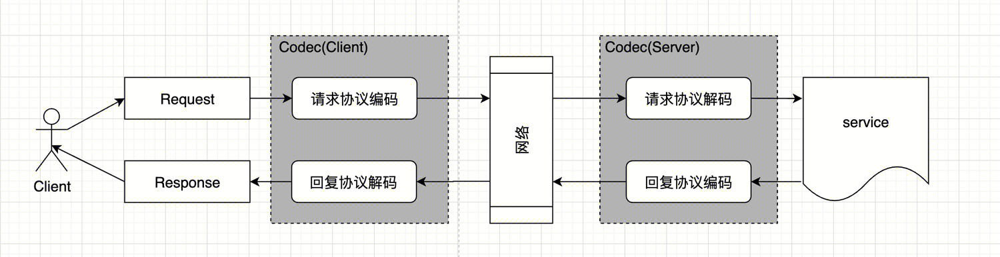
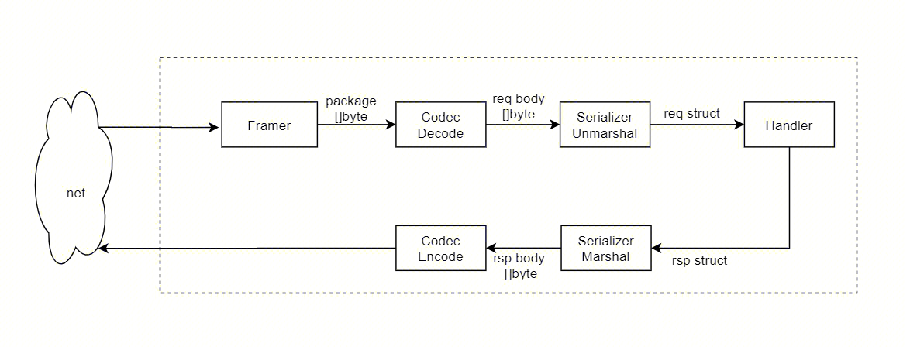
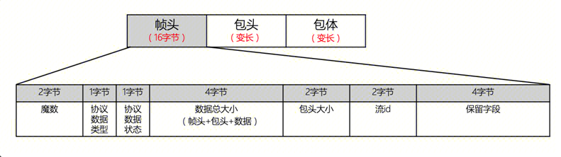
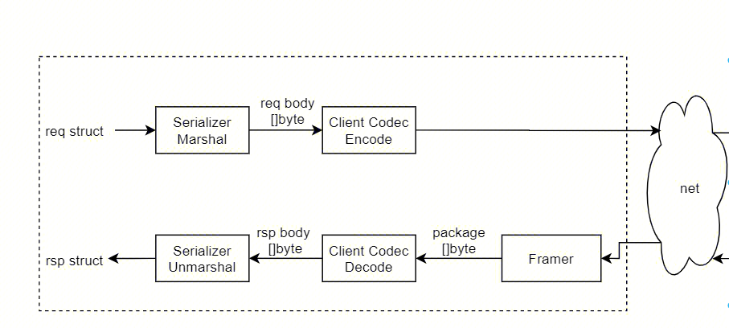

# 怎么开发一个协议插件

在 tRPC-Python 中，一个协议名称（如内置的 `trpc` 和 `http`）串联起了服务端和客户端的**切帧（Checker/Framer）**与**编解码（Codec）**四个扩展槽位。

本文将通过实现一个按换行符 `\n` 切分报文的自定义协议 `line`，演示如何将这四个槽位接入框架默认的 TCP 传输层。与所有其他插件一样，协议插件在定义它的模块被 `import` 时完成注册，因此请在服务入口调用 `create_server`（或客户端加载配置）之前先导入该插件模块。

## 协议调用链路总览



一次完整的 RPC 调用按以下顺序流转（注：图中“网络”两侧的灰色方块代表 Codec，而网络流切帧发生在进入 Codec 之前，序列化则发生在 Codec 与业务处理之间）：

- **客户端发送与接收（`_invoke_backend`）**：
  1. 发送时：按 `message` 上的类型依次执行**序列化（Serialize）** → **压缩（Compress）** → **`codec.encode_data`**（此时传入 `encode_data` 的 `body` 已经是序列化并压缩后的 `bytes`）。
  2. 接收时：先由 **`checker.read_frame`** 从连接切出完整响应帧 → **`codec.decode_data`** 解码 → **解压（Decompress）** → **反序列化（Deserialize）**。
- **服务端接收与回复（`Service.handle`）**：
  1. 接收时：TCP 连接收到字节流后，先由 **`checker`** 切出完整请求帧，随后进入 `Service.handle` 依次执行 **`await codec.decode_data`** → 按 `message.compress_type` **解压** → 按 `message.serialization_type` **反序列化** → 进入过滤器链与业务函数。
  2. 回复时：依次执行**序列化** → **压缩** → **`codec.encode_data`**，最后写回网络。

### `protocol` 配置项如何关联插件

YAML 配置中的 `protocol` 字符串即为这四个槽位的统一注册名：
- **服务端**：`ServiceOption.set_protocol(protocol)` 会按该名称查找并挂载 `get_server_codec` 和 `get_server_parser`。在创建服务时，若该协议名未注册专属的 `SERVER_TRANSPORT`，`create_server` 会自动使用基础的 `TrpcServerTransport`（即复用框架内置的 TCP/UDP 监听）。
- **客户端**：`Options.set_protocol(protocol)` 会按该名称查找 `CLIENT_CODEC`、`CLIENT_CHECKER` 和 `CLIENT_TRANSPORT`。若未注册同名的客户端 Transport，则继续保留默认的 `trpc` 客户端传输层。

因此，如果只是在 TCP 之上自定义报文格式（如本文的 `line` 协议），**只需注册四个 Checker 与 Codec 插件**，传输层可直接复用框架内置的 TCP 实现。

## 1. 服务端切帧器（`SERVER_CHECKER`）



图中标注为 **Framer** 的环节对应抽象基类 `BaseServerProtocolParser`（从 `trpc_sdk.abc` 导入），需实现以下三个方法：

- `feed_data(data: bytes) -> None`：将新收到的网络字节追加到当前连接的缓冲区中。
- `read() -> List[bytes]`：从缓冲区中切出所有已收齐的完整帧并返回（同时将它们从缓冲区移除）；若尚无完整帧则返回空列表 `[]`。
- `reset() -> None`：清空缓冲区。

**为什么必须使用工厂模式注册？**
每当建立一条新的 TCP 连接时，底层协议对象（位于 `_tcp_protocol.pyx`、dispatcher 或 executor 中）都会调用 `checker.create()` 为该连接创建一个独立的 Parser 实例，并在 `data_received` 时调用 `feed_data` 和 `read`。因此，注册到 `PluginType.SERVER_CHECKER` 的必须是一个返回 `BasePluginFactory` 的函数，由工厂的 `create()` 方法为每条连接生成独立的缓冲区。

> 注意：`BaseServerProtocolParser` 基类自带的 `feed_data` 写入的是纯 Python 无法直接读取的内部缓冲区。因此在纯 Python 中实现自定义 Parser 时，请自行维护一个 `bytearray` 并同时重写 `feed_data`、`read` 和 `reset` 三个方法。

下面实现按 `b"\n"` 切帧的 `LineServerParser`（切出的帧保留末尾的 `\n`，交由后续 Codec 去除）：

```python
from typing import List

from trpc_sdk.abc import BasePluginFactory
from trpc_sdk.abc import BaseServerProtocolParser
from trpc_sdk.abc import PluginType
from trpc_sdk.plugin import register_plugin


class LineServerParser(BaseServerProtocolParser):
    """Split a TCP stream into newline-terminated frames."""

    def __init__(self) -> None:
        self._buf = bytearray()

    def feed_data(self, data: bytes) -> None:
        self._buf.extend(data)

    def read(self) -> List[bytes]:
        frames = []
        while True:
            index = self._buf.find(b"\n")
            if index < 0:
                break
            frames.append(bytes(self._buf[: index + 1]))
            del self._buf[: index + 1]
        return frames

    def reset(self) -> None:
        self._buf.clear()


class LineCheckerFactory(BasePluginFactory):
    """Hand out one line parser per connection."""

    def create(self) -> LineServerParser:
        return LineServerParser()


@register_plugin(PluginType.SERVER_CHECKER, "line")
def setup_line_checker() -> LineCheckerFactory:
    return LineCheckerFactory()
```

**对比框架内置实现**：
- **`trpc` 协议**：内置的 `TrpcServerProtocolChecker` 根据固定的 16 字节帧头（校验魔数 `2352` 并读取总长度 `package_len`）进行切帧，不在此阶段解析具体的 Protobuf 协议头。
  
- **`http` 协议**：`ServerHttpChecker` 仅作为占槽注册。因为 HTTP 报文由底层的 `aiohttp` 完成解析，不会走框架的 TCP `data_received` 切帧流程。

## 2. 客户端切帧器（`CLIENT_CHECKER`）



客户端的接收方向先经过图中标为 **Framer** 的 `BaseClientProtocolParser`，再进入 `decode_data` 和反序列化。

与服务端不同，客户端切帧器继承 `BaseClientProtocolParser`（本身即为 `BasePlugin` 子类），直接将类注册为单例即可。它需要实现异步方法 `async def read_frame(self, connection) -> bytes`，客户端 TCP 传输层会直接 `await` 该方法从连接池连接（`PooledConnection`）中读取一帧完整响应。

`PooledConnection.read(n)` 每次会异步读满 `n` 个字节。下面为演示原理，每次读取 1 个字节直到遇到 `b"\n"`（当连接关闭或读取异常时，捕获并统一转换为 `ClientDecodeError`）：

```python
from trpc_sdk.abc import BaseClientProtocolParser
from trpc_sdk.abc import PluginType
from trpc_sdk.exceptions import ClientDecodeError
from trpc_sdk.plugin import register_plugin


@register_plugin(PluginType.CLIENT_CHECKER, "line")
class LineClientParser(BaseClientProtocolParser):
    """Read one newline-terminated frame from a pooled connection."""

    async def read_frame(self, connection) -> bytes:
        chunks = []
        while True:
            try:
                piece = await connection.read(1)
            except Exception as err:
                raise ClientDecodeError("line connection closed") from err
            chunks.append(piece)
            if piece == b"\n":
                return b"".join(chunks)
```

> **对比内置实现**：内置的 `TrpcClientParser` 会先读 16 字节帧头，若魔数不是 `2352`，会立即调用 `conn.close(True)` 销毁该连接（因为字节流已失步，无法对齐下一帧），再抛出 `ClientDecodeError`。而 `ClientHttpChecker.read_frame` 直接抛出 `NotImplementedError`，因为 HTTP 响应由 `aiohttp` 负责读取。

## 3. 服务端与客户端编解码器（`SERVER_CODEC` / `CLIENT_CODEC`）

编解码器继承自 `BaseCodec`，需要实现一对方法（第一个参数均为 `TrpcContext`）：

- `encode_data(context, body) -> bytes`
- `decode_data(context, buffer) -> bytes`

**特别注意同步与异步签名的区别**：
- **服务端 `decode_data` 必须定义为 `async def`**：因为服务端 `Service.handle` 会使用 `await codec.decode_data(...)` 调用它。
- **客户端 `decode_data` 以及双端的 `encode_data` 均为普通同步函数（`def`）**：框架在调用这三个方法时不会 `await`，直接返回 `bytes` 即可。

### 实现 `line` 协议的 Codec

`line` 协议的帧格式约定非常简单：
- `encode_data`：在已序列化的 `body` 末尾追加一个 `\n`。
- `decode_data`：去掉切帧器交出的帧末尾的 `\n`，还原出 `body` 字节流（注意：`rstrip(b"\n")` 会去除末尾所有换行符，因此原始 `body` 自身不应以 `\n` 结尾）。

在服务端 `decode_data` 中，还需要设置两个关键的 `message` 属性：
1. **设置路由方法名（`server_rpc_name`）**：`Service.handle` 依赖 `message.get_server_rpc_name()` 查找已注册的 RPC 处理函数（格式形如 `/service/method`；若注册服务时指定了 `fix_rpc_name=True`，其中 `service` 段会被替换为 YAML 中的服务 `name`）。由于简单的 `line` 帧里没有携带方法名字段，我们在下面的示例中将其固定设为 `"/trpc.app.server.Greeter/SayHello"`（实际协议可将方法名编入帧头并在 `decode_data` 中解析出来）。
2. **设置序列化类型（`serialization_type`）**：新建 `message` 的默认序列化类型是 `0`（即 Protobuf）。如果业务希望直接收发原始字节而不走 Protobuf 解析，需要在 `decode_data` 中调用 `message.set_serialization_type(SerializationType.Noop)`。

完整代码如下：

```python
from typing import Optional

from trpc_sdk.abc import BaseCodec
from trpc_sdk.abc import PluginType
from trpc_sdk.abc import TrpcContext
from trpc_sdk.abc import get_message
from trpc_sdk.plugin import register_plugin
from trpc_sdk.serialization import SerializationType


@register_plugin(PluginType.SERVER_CODEC, "line")
class LineServerCodec(BaseCodec):
    """Newline-terminated server codec."""

    def encode_data(self, context: TrpcContext, body: Optional[bytes]) -> bytes:
        return (body or b"") + b"\n"

    async def decode_data(self, context: TrpcContext, buffer: Optional[bytes]) -> bytes:
        message = get_message(context)
        message.set_server_rpc_name("/trpc.app.server.Greeter/SayHello")
        message.set_serialization_type(SerializationType.Noop)
        return (buffer or b"").rstrip(b"\n")


@register_plugin(PluginType.CLIENT_CODEC, "line")
class LineClientCodec(BaseCodec):
    """Newline-terminated client codec."""

    def encode_data(self, context: TrpcContext, body: Optional[bytes]) -> bytes:
        return (body or b"") + b"\n"

    def decode_data(self, context: TrpcContext, buffer: Optional[bytes]) -> bytes:
        return (buffer or b"").rstrip(b"\n")
```

> 补充说明：
> - **HTTP Codec 的工作方式**：内置的 `ServerHttpCodec` 不负责拼接 TCP 帧，而是从 `message` 上获取 `aiohttp` 的 request 和 response 对象——在 `decode_data` 中从 request 读取 body（忽略 `buffer` 参数），在 `encode_data` 中将状态码和响应头写入 response 并返回 body。
> - **流式编解码**：`BaseCodec` 上的 `encode_stream` / `decode_stream` 专供 tRPC 流式协议使用，普通一元协议无需实现。

## 4. 序列化与压缩插件（可选）

序列化与压缩是独立于协议之外的两个插件槽位：
- **序列化（`PluginType.SERIALIZATION`）**：继承 `BaseSerializer`，实现 `serialize` 和 `deserialize`。其注册名使用的是 `SerializationType` 枚举的整型值（`PB = 0`、`JCE = 1`、`JSON = 2`、`FlatBuffer = 3`、`Noop = 4`）。
- **压缩（`PluginType.COMPRESS`）**：继承 `BaseCompress`，实现 `compress` 和 `decompress`。其注册名使用的是 `CompressType` 枚举的整型值（默认不压缩为 `CompressType.Noop = 0`）。

在本文的 `line` 协议示例中，报文头不包含序列化类型字段，因此双方约定使用 `SerializationType.Noop`（值为 `4`）直接收发原始字节：
- **服务端**：已在上面 `LineServerCodec.decode_data` 中设置为 `SerializationType.Noop`。`Noop` 反序列化器会将原始字节写入 `trpc_sdk.serialization.Body` 对象的 `data` 属性中。
- **客户端**：在 YAML 中配置 `serialization: 4`，或在调用时通过 `Options().set_serialization_type(SerializationType.Noop)` 指定。

## 5. 自定义传输层与自定义监听（可选）

如果自定义协议仍然运行在框架标准的 TCP 或 UDP 事件循环之上（如本文的 `line` 协议），则**不需要**实现以下两项。仅当需要接管底层网络收发或监听逻辑时才按需选用：

1. **替换传输层（`SERVER_TRANSPORT` / `CLIENT_TRANSPORT`）**：
   以相同的协议名注册传输插件。客户端侧替换 `CLIENT_TRANSPORT` 的典型用法（如对接第三方数据库 SDK）可参考 [数据库插件](database.zh_CN.md)。
2. **接管服务端监听循环（`register_protocol_handle`）**：
   从 `trpc_sdk.server` 或 `trpc_sdk.runtime` 导入 `register_protocol_handle(protocol, starter)`，并在 `serve()` fork 子进程之前（通常在模块导入时）调用。注册后，框架会将使用该协议的服务地址标记为用户接管协议，不再启动内置的 TCP 或 HTTP 监听，而是调用 `starter(worker, index)` 由插件自己在事件循环上执行 `bind`（注意：在 `separate` 多进程模式下，多个进程会绑定同一地址，套接字需开启 `SO_REUSEPORT`）。

## 6. 配置与使用

确保服务启动入口已导入包含 `LineCheckerFactory`、`LineClientParser`、`LineServerCodec`、`LineClientCodec` 的模块后，按如下方式配置：

### 服务端配置

```yaml
server:
  service:
    - name: trpc.app.server.Greeter
      protocol: line
      network: tcp
      ip: 127.0.0.1
      port: 8000
```

### 客户端配置

客户端除了指定 `protocol: line` 外，还需配置目标地址 `target`（其中 `ip://` 为名字服务 Selector，详见 [名字服务插件](naming.zh_CN.md)）以及 `serialization: 4`（即 `SerializationType.Noop`）：

```yaml
client:
  service:
    - name: trpc.app.server.Greeter
      protocol: line
      network: tcp
      target: ip://127.0.0.1:8000
      serialization: 4
```

也可以在代码中通过 `Options().set_protocol("line")` 指定协议。注意：如果客户端在调用 `set_protocol("line")` 时尚未导入插件模块（导致找不到名为 `"line"` 的 `CLIENT_CODEC`），`set_protocol` 会静默返回，随后发起调用时将抛出 `ClientEncodeError`。
