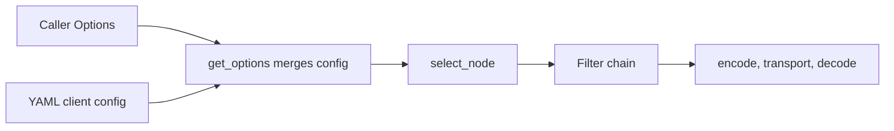

English | [中文](overview.zh_CN.md)

# Client Development Guide

An outbound RPC call in tRPC-Python is assembled as `Options` and then executed by `Client.invoke`. A protobuf stub (proxy) is only a thin wrapper over that path. The proxy itself does not keep network connections.

The public client API is in `trpc_sdk.client` (`Client`, `get_client`, and `Options`). The call context is `trpc_sdk.abc.TrpcContext`.

## How Call Options Are Merged

On each call, `get_options` builds the final `Options` in this order. A later step overwrites the same field from an earlier step:

1. **Framework defaults.** The selector is `TrpcSelector`, serialization is `SerializationType.PB`, and compression is `CompressType.Noop`.
2. **YAML.** The callee service name on the `TrpcMessage` selects the matching entry under `client` in `trpc_python.yaml`.
3. **Caller `Options`.** The `Options` passed in code for this call are applied last.



Node selection (`select_node`) finishes before the client filter chain. The chain wraps serialization, compression, frame encoding, transport, and response decoding. How to write a filter is in the [Filter Plugin](../../developer_guide/develop_plugins/filter.md).

## 1. Calling Downstream from a Server Handler

`create_server(conf_path)` already calls `TrpcConfig.load`. Inside a handler, pass the `ctx` the handler received into the downstream proxy. The upstream deadline and the propagated metadata stay on that context:

```python
from trpc_sdk.abc import TrpcContext
from trpc_sdk.client import Options
from trpc_sdk.serialization import SerializationType

class GreeterServicer(rpc.GreeterServicer):
    """Downstream call from inside a request handler."""

    async def SayHello(self, ctx: TrpcContext, request: pb.HelloRequest) -> pb.HelloReply:
        """Forward SayHello to another Greeter."""
        proxy = rpc.GreeterClientProxyImpl()
        req = pb.HelloRequest()
        req.msg = request.msg
        options = (
            Options()
            .set_target("ip://127.0.0.1:8000")
            .set_protocol("trpc")
            .set_serialization_type(SerializationType.PB)
            .set_network("tcp")
        )
        return await proxy.asyncSayHello(ctx, req, options)
```

`GreeterClientProxyImpl` defaults to `need_clone_ctx=True`. It clones a client `TrpcMessage` before the call, so this outbound call does not modify the server request that is being handled.

## 2. A Standalone Client

A script that does not start a `Server` must call `TrpcConfig.load` itself and build a `TrpcContext` itself. If you use a custom plugin, import that plugin module before `TrpcConfig.load` so it is registered:

```python
from trpc_sdk.abc import TrpcContext
from trpc_sdk.client import Options
from trpc_sdk.config import TrpcConfig
from trpc_sdk.serialization import SerializationType

TrpcConfig.load("./trpc_python.yaml", "utf-8")


async def say_hello() -> pb.HelloReply:
    """Call Greeter from a standalone client."""
    proxy = rpc.GreeterClientProxyImpl()
    req = pb.HelloRequest()
    req.msg = "hello"
    options = (
        Options()
        .set_target("ip://127.0.0.1:8000")
        .set_protocol("trpc")
        .set_serialization_type(SerializationType.PB)
        .set_network("tcp")
        .set_namespace("Development")
        .set_timeout(3000)
    )
    ctx = TrpcContext()
    return await proxy.asyncSayHello(ctx, req, options)
```

When both `target` and `protocol` are set on `Options` in code, `trpc_python.yaml` does not need a `client.service` entry of the same name. When no entry matches the callee service name, the framework falls back to the shared `timeout`, `namespace`, and `filter` on the top-level `client` section.

## 3. Generated Stub Code (Proxy)

The generated `GreeterClientProxyImpl` writes the full RPC path, the callee service name, and the method name onto the `TrpcMessage`, then sends the request with `get_client()`:

- **Async:** `await proxy.asyncSayHello(ctx, req, options)` calls `Client.invoke`.
- **Sync:** `proxy.SayHello(ctx, req, options)` calls `Client.invoke_sync`.

- **Custom service name (`service_name`).** `GreeterClientProxyImpl(service_name=...)` defaults to the service name in the `.proto` file, and that name is the YAML lookup key. A custom name replaces both the YAML lookup key and the service name in the RPC path. With `fix_rpc_name=False`, only the YAML lookup key changes. The RPC path that is sent stays the original proto text.
- **`options` shape.** Pass one chained `Options()` object, or a list of `Options`. The framework applies the list onto this request in order:

```python
options = [
    Options().set_target("ip://127.0.0.1:8000"),
    Options().set_protocol("trpc"),
    Options().set_timeout(3000),
]
reply = proxy.SayHello(ctx, req, options)
```

- **Cheap to construct.** A proxy is lightweight and can be created for each call. The `Client` returned by `get_client()` is a process-wide singleton. The connection pool lives in `transport`, not on the proxy.
- **Generic HTTP RPC.** The same stub can carry this RPC over HTTP with `Options().set_protocol("http")`. To send a standard HTTP request by URL without a stub, see the [HTTP Client](http.md).

## 4. Calling `Client.invoke` Without a Stub

`get_client().invoke(...)` requires the caller to set the callee service name, the RPC path, and the method name on the `TrpcMessage`, and to pass the response class `rsp_cls`. The framework builds an empty instance with `rsp_cls()` and fills it by deserialization:

```python
from trpc_sdk.abc import TrpcContext
from trpc_sdk.client import Options
from trpc_sdk.client import get_client

ctx = TrpcContext()
msg = ctx.get_message()
msg.set_callee_service_name("trpc.test.helloworld.Greeter")
msg.set_client_rpc_name("/trpc.test.helloworld.Greeter/SayHello")
msg.set_callee_method("SayHello")

options = Options().set_target("ip://127.0.0.1:8000").set_protocol("trpc")
reply = await get_client().invoke(ctx, req, pb.HelloReply, options)
```

## 5. Common `Options` Methods

A `set_*` in code overrides YAML, and YAML overrides the framework defaults. The table lists the common methods. `Options` also has connection-pool, TLS, and streaming-window settings.

| Method | Role |
| --- | --- |
| `set_target(target)` | Addressing target `scheme://endpoint`. Decides which `Selector` plugin is used |
| `set_service_name(name)` | Override the service name from YAML, and use it as the `endpoint` of this selection |
| `set_protocol(protocol)` | Protocol name. Looks up and binds the `codec`, `checker`, and `transport` |
| `set_network(network)` | Transport network: `tcp` or `udp` |
| `set_serialization_type(t)` | Serialization type. Default `SerializationType.PB` |
| `set_compress_type(t)` | Compression type. Default `CompressType.Noop` |
| `set_timeout(ms)` | Timeout of this client call, in milliseconds |
| `set_namespace(ns)` | Namespace of the callee service |
| `set_metadata(key, val)` | Add one cross-process key-value pair. `val` must be `bytes` |

`set_protocol(name)` looks up a registered `codec`, `checker`, and `transport` by that name. If no codec of that name is registered, all three stay at the values they had before the call. If a codec is found but no transport of the same name is registered, only the `codec` and the `checker` are replaced. The transport stays the default implementation.

## 6. Client YAML

In `trpc_python.yaml`, the top-level `client` section is shared by every downstream service. `client.service[]` is one downstream service. It maps to `ClientServiceConfig`: YAML `name` becomes `service_name`, `filter` becomes `filters`, `loadbalance` becomes `load_balance`, and `circuitbreaker` becomes `circuit_breaker`.

```yaml
client:
  timeout: 1000
  namespace: Development
  filter:
    - trace
  service:
    - callee: trpc.test.helloworld.Greeter
      name: trpc.test.helloworld.Greeter
      target: ip://127.0.0.1:8000
      network: tcp
      protocol: trpc
      timeout: 800
      serialization: 0
      compression: 0
```

A name in `filter` must be a registered client filter. `trace` in the example only marks the position. This repository does not ship a plugin under that name.

### Inheritance and Lookup

- **Base fields.** When a `service` omits `namespace`, `network`, or `protocol`, it inherits the value from the outer `client` section. When `client.namespace` is also omitted, it inherits `global.namespace`.
- **Naming sub-plugins.** When a `service` omits `target`, its `discovery`, `loadbalance`, and `circuitbreaker` are also inherited from the outer `client` section.
- **Filter merge.** The outer `client.filter` is inserted in front of that service's `filter` list. A duplicate name keeps only the earlier copy.
- **Timeout.** The outer `client.timeout` is stored only on the fallback configuration. It applies only when no `client.service[]` entry matches the service name. When a matched `service` omits `timeout`, the timeout stays `0` and this call does not set another client deadline.
- **Lookup key (`callee` and `name`).** When `callee` is set, it is the lookup key. Otherwise `name` is the lookup key. The callee service name the stub writes onto the message must match that key, or the YAML entry is not applied. `Options.set_service_name` runs after YAML is loaded. It overrides the selection `endpoint` and writes the new name back onto the message.

Connection-pool and short-connection fields (`short_conn`, `dial_timeout`, `idle_time`, `max_conn_lifetime`, `max_idle_conn`, `max_active_conn`, `is_wait_active_conn`, and HTTP's `disable_reuse_http_session`) are in [Client Connection Modes](connection_mode.md).

## 7. Addressing (Naming and Selector)

The client addresses a peer in two ways:

1. **No `target` (`TrpcSelector` chain).** The default selector is `TrpcSelector`. It picks one node through discovery, the service router, load balance, and the circuit breaker. The selection `endpoint` starts as the callee service name on the message. When the matching YAML `service` sets `name`, that `name` replaces it.
2. **`target` set (one `Selector`).** The value must be `scheme://endpoint` and contain exactly one `://`. The framework looks up the `NAMING_SELECTOR` plugin registered under that scheme and passes the `endpoint` after `://` to it. A bad format, or a selection that does not produce a valid address, raises `ClientRouteError`.

Schemes that ship with this repository:

- `ip`, `http`, and `https`: parse the `endpoint` as `host:port` and do not query DNS. Several addresses are separated by commas, and one is picked at random.
- `dns`: also accepts a comma-separated list and picks one at random, then resolves the host name with DNS.
- `dsn`: the full string after `://` is placed in `Node.address` as-is.

An external naming plugin registers its own scheme as `NAMING_SELECTOR`. See [How to Write a Naming Plugin](../../developer_guide/develop_plugins/naming.md).

## 8. Client Filters

Filter names in YAML become filter instances when the client configuration is loaded, and they are attached to this call's `Options`. Code can also append an already constructed client filter with `set_filter` or `set_filter_list`:

```python
options = Options().set_target("ip://127.0.0.1:8000").set_protocol("trpc").set_filter(trace_filter)
```

- The default is to append to the list already attached. `override=True` clears that list and keeps only the instances passed this time.
- A filter earlier in the list sits on the outside: its pre-logic runs first, and its post-logic runs last. Node selection finishes before the chain is entered.

## 9. Synchronous and Asynchronous Calls

- **Async (preferred).** `await proxy.asyncSayHello(...)` and `await Client.invoke(...)` are coroutines. `await` them on the event loop that is already running.
- **Sync.** `proxy.SayHello(...)` and `Client.invoke_sync(...)` block the current thread until the call finishes. If this thread has no event loop yet, the framework creates one and binds it to the thread. Do not call the synchronous entry when this thread's event loop is already running, for example from inside an `async def`. That raises an event-loop conflict.

## 10. Timeout and Metadata

- **Timeout.** Both `set_timeout` and YAML `timeout` are in milliseconds. `0` means this call does not set another client deadline. When the value is greater than `0`, the framework takes the earlier of that value and the upstream `ctx.deadline`. If the client timeout is earlier, or the upstream context has no deadline, a later timeout is charged to the downstream call. If the upstream deadline is earlier, the timeout is charged to the current service and is not reported to the `Selector` as a downstream node failure. See [Timeout Control](../timeout_control.md).
- **Metadata.** `Options().set_metadata(key, val)` (`val` is `bytes`) merges the pair into `client_meta_data` of this request. The codec writes it into the frame header sent downstream. The server reads it from `server_meta_data`. See [Metadata Propagation](../metadata_transmission.md).

```python
options = Options().set_metadata("key", b"value")
```

## 11. Serialization, Compression, and Raw Bytes (Noop)

The defaults are `SerializationType.PB` and `CompressType.Noop`. Other common serializations are `SerializationType.JSON` and `SerializationType.Noop`. Compression types are in `trpc_sdk.compressor.CompressType`, for example `Gzip`. YAML `serialization` and `compression` are the integer enum values. `0` is PB and no compression, respectively.

### Passing Through Already-Serialized Bytes

In a proxy or forwarding path, the request body may already be serialized `bytes` (for example an encoded protobuf payload). This process should not serialize it again, but the frame header should still tell the peer to parse the body as protobuf. Use `trpc_sdk.serialization.Body` together with `set_current_serialization_type`:

- `set_serialization_type(SerializationType.PB)` is written on the frame header. It tells the peer that the body format is PB.
- `set_current_serialization_type(SerializationType.Noop)` only decides that **this process** uses `NoopSerializer` to read and write raw bytes. It does not change the serialization type announced on the frame header.

```python
from trpc_sdk.abc import TrpcContext
from trpc_sdk.abc import create_message
from trpc_sdk.client import Client
from trpc_sdk.client import Options
from trpc_sdk.serialization import Body
from trpc_sdk.serialization import SerializationType

ctx = TrpcContext()
create_message(ctx)
rsp = await Client().invoke(
    ctx,
    Body(data=raw_bytes),
    Body,
    [
        Options()
        .set_target("ip://127.0.0.1:8000")
        .set_protocol("trpc")
        .set_serialization_type(SerializationType.PB)
        .set_current_serialization_type(SerializationType.Noop),
    ],
)
payload = rsp.data
```

When serializing a request, `NoopSerializer` accepts a `Body` or bare `bytes`. When deserializing a response, it writes bytes only into `Body.data`, so `rsp_cls` must be `Body`.

## 12. The Node Selected for This Call

After `select_node` picks a node, it writes the node address to `message.remote_addr` of this call. Stub code clones the context by default, so the `ctx` the caller passed in does not show that change.

To read the downstream address and the call cost after the call, construct a `Node` first. `service_name` is required; pass `""` before the call. Pass the node with `Options.set_selector_node(node)`. When the call finishes, the framework fills `address`, `service_name`, and `cost_time` on that object:

```python
from trpc_sdk.abc import Node

node = Node(service_name="")
options = (
    Options()
    .set_target("ip://127.0.0.1:8000")
    .set_protocol("trpc")
    .set_selector_node(node)
)
reply = await proxy.asyncSayHello(ctx, req, options)
print(node.address, node.cost_time)
```

## 13. Other Protocols

- **HTTP and SSE.** The built-in HTTP client and the SSE streaming client are in the [HTTP Client](http.md) and the [HTTP SSE Client](sse.md).
- **Ecosystem protocols.** Redis, MySQL, Kafka, TAF, MCP, A2A, and vector databases come from separate plugin repositories. How a database plugin is attached is in [How to Write a Database Plugin](../../developer_guide/develop_plugins/database.md).
