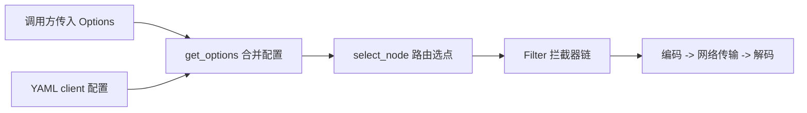

# tRPC-Python 客户端开发向导

在 tRPC-Python 中，发起一次出站 RPC 调用的核心流程是：先组装调用选项 `Options`，再交由 `Client.invoke` 执行。Protobuf 生成的桩代码（Proxy）只是对这一流程的轻量封装，其自身并不维护网络连接。

客户端核心公开接口位于 `trpc_sdk.client` 模块（包括 `Client`、`get_client`、`Options`），调用上下文使用 `trpc_sdk.abc.TrpcContext`。

## 调用选项合并与执行顺序

每次调用时，`get_options` 会严格按以下优先级顺序组装最终的 `Options`（后执行的覆盖先执行的同名字段）：

1. **框架默认值**：路由选点器（Selector）默认为 `TrpcSelector`，序列化类型默认为 `SerializationType.PB`（Protobuf），压缩类型默认为 `CompressType.Noop`（不压缩）。
2. **YAML 配置文件**：根据 `TrpcMessage` 上的被调服务名，匹配并应用 `trpc_python.yaml` 中 `client` 段的配置。
3. **调用方传入的 `Options`**：最后应用本次调用时通过代码传入的 `Options` 参数。



如图所示，路由选点（`select_node`）在进入客户端拦截器链之前完成；拦截器链内部包裹着序列化、压缩、协议帧编码、网络传输与响应解码过程（关于拦截器的编写方式，请参考 [过滤器插件](../../developer_guide/develop_plugins/filter.zh_CN.md)）。

## 1. 在服务端 Handler 内调用下游

当通过 `create_server(conf_path)` 启动服务端时，框架已自动执行了 `TrpcConfig.load`。在业务 Handler 中调用下游服务时，只需将 Handler 接收到的 `ctx` 继续传给下游 Proxy，即可保留上游传入的超时截止时间（`deadline`）与链路透传信息：

```python
from trpc_sdk.abc import TrpcContext
from trpc_sdk.client import Options
from trpc_sdk.serialization import SerializationType

class GreeterServicer(rpc.GreeterServicer):
    """Downstream call from inside a request handler."""

    async def SayHello(self, ctx: TrpcContext, request: pb.HelloRequest) -> pb.HelloReply:
        """Forward SayHello to another Greeter."""
        proxy = rpc.GreeterClientProxyImpl()
        req = pb.HelloRequest()
        req.msg = request.msg
        options = (
            Options()
            .set_target("ip://127.0.0.1:8000")
            .set_protocol("trpc")
            .set_serialization_type(SerializationType.PB)
            .set_network("tcp")
        )
        return await proxy.asyncSayHello(ctx, req, options)
```

> 说明：`GreeterClientProxyImpl` 默认开启 `need_clone_ctx=True`，会在发起调用前自动克隆一份客户端 `TrpcMessage`，从而避免本次下游调用修改当前正在处理的服务端请求消息。

## 2. 独立客户端（纯客户端脚本）

若在未启动 `Server` 的独立脚本中发起调用，需要手动调用 `TrpcConfig.load` 加载配置，并自行构造 `TrpcContext`。若使用了自定义插件，请确保在调用 `TrpcConfig.load` 之前先 `import` 对应的插件模块以完成注册：

```python
from trpc_sdk.abc import TrpcContext
from trpc_sdk.client import Options
from trpc_sdk.config import TrpcConfig
from trpc_sdk.serialization import SerializationType

TrpcConfig.load("./trpc_python.yaml", "utf-8")


async def say_hello() -> pb.HelloReply:
    """Call Greeter from a standalone client."""
    proxy = rpc.GreeterClientProxyImpl()
    req = pb.HelloRequest()
    req.msg = "hello"
    options = (
        Options()
        .set_target("ip://127.0.0.1:8000")
        .set_protocol("trpc")
        .set_serialization_type(SerializationType.PB)
        .set_network("tcp")
        .set_namespace("Development")
        .set_timeout(3000)
    )
    ctx = TrpcContext()
    return await proxy.asyncSayHello(ctx, req, options)
```

如果目标地址（`target`）和协议（`protocol`）均已在代码的 `Options` 中显式指定，则 `trpc_python.yaml` 中无需配置同名的 `client.service` 条目。当按被调服务名在 YAML 中找不到匹配项时，框架会回退使用 `client` 顶层段配置的公共 `timeout`、`namespace` 和 `filter`。

## 3. 使用生成的桩代码（Proxy）

Protobuf 生成的 `GreeterClientProxyImpl` 会在调用前自动将完整 RPC 路径、被调服务名（Callee）和方法名写入 `TrpcMessage`，然后调用 `get_client()` 发送请求：
- **异步调用**：`await proxy.asyncSayHello(ctx, req, options)`（底层调用 `Client.invoke`）。
- **同步调用**：`proxy.SayHello(ctx, req, options)`（底层调用 `Client.invoke_sync`）。

关于 Proxy 的使用细节：
- **自定义服务名（`service_name`）**：构造 `GreeterClientProxyImpl(service_name=...)` 时，默认使用 `.proto` 文件中定义的服务名，并以此作为查找 YAML 配置的键。若传入了自定义服务名，则 YAML 查找键和请求中的 RPC 路径都会替换为该名称；若同时传入 `fix_rpc_name=False`，则仅替换 YAML 查找键，发出的 RPC 路径仍保持 `.proto` 中的原始定义。
- **`options` 参数形式**：既可以传入单个链式调用的 `Options()` 对象，也可以传入 `Options` 对象组成的列表（框架会按列表顺序依次应用到本次请求的配置上）：

```python
options = [
    Options().set_target("ip://127.0.0.1:8000"),
    Options().set_protocol("trpc"),
    Options().set_timeout(3000),
]
reply = proxy.SayHello(ctx, req, options)
```

- **轻量实例化**：Proxy 实例非常轻量，可在每次调用时按需创建。`get_client()` 返回的 `Client` 是进程内单例，底层的连接池维护在 `transport` 层而非 Proxy 实例上。
- **切换为泛 HTTP RPC**：使用同一套桩代码，只需设置 `Options().set_protocol("http")`，即可改用 HTTP 协议承载该 RPC 调用（若不通过桩代码、直接按 URL 发送标准 HTTP 请求，请参考 [HTTP 客户端使用指南](http.zh_CN.md)）。

## 4. 不使用桩代码直接调用（`Client.invoke`）

如果不使用生成的桩代码，直接调用 `get_client().invoke(...)`，则需要调用方自行在 `TrpcMessage` 上设置被调服务名、RPC 路径和方法名，并传入响应类型 `rsp_cls`（框架会调用 `rsp_cls()` 构造空实例并反序列化填充）：

```python
from trpc_sdk.abc import TrpcContext
from trpc_sdk.client import Options
from trpc_sdk.client import get_client

ctx = TrpcContext()
msg = ctx.get_message()
msg.set_callee_service_name("trpc.test.helloworld.Greeter")
msg.set_client_rpc_name("/trpc.test.helloworld.Greeter/SayHello")
msg.set_callee_method("SayHello")

options = Options().set_target("ip://127.0.0.1:8000").set_protocol("trpc")
reply = await get_client().invoke(ctx, req, pb.HelloReply, options)
```

## 5. 常用 `Options` 方法一览

代码中通过 `Options().set_*` 设置的选项优先级高于 YAML 配置，YAML 配置优先级高于框架默认值。下表列出最常用的设置方法（此外 `Options` 还支持连接池、TLS、流式窗口等参数）：

| 方法 | 作用说明 |
| --- | --- |
| `set_target(target)` | 设置寻址目标 `scheme://endpoint`，决定使用哪个 `Selector` 插件 |
| `set_service_name(name)` | 覆盖 YAML 中的服务名，并将其作为本次路由选点的 `endpoint` |
| `set_protocol(protocol)` | 设置协议名称，用于查找并绑定对应的 `codec`、`checker` 和 `transport` |
| `set_network(network)` | 设置传输层网络类型：`tcp` 或 `udp` |
| `set_serialization_type(t)` | 设置序列化类型，默认为 `SerializationType.PB` |
| `set_compress_type(t)` | 设置压缩类型，默认为 `CompressType.Noop` |
| `set_timeout(ms)` | 设置本次客户端调用的超时时间（毫秒） |
| `set_namespace(ns)` | 设置被调服务所在的命名空间 |
| `set_metadata(key, val)` | 添加一条跨进程透传的键值对（`val` 必须为 `bytes`） |

> **关于 `set_protocol` 的查找机制**：调用 `set_protocol(name)` 时，框架会按名称查找已注册的 `codec`、`checker` 和 `transport`。如果未找到同名的 `codec`，则这三项均保持调用前的原值不变；如果找到了同名 `codec` 但未注册同名的 `transport`，则仅替换 `codec` 和 `checker`，传输层保留默认实现。

## 6. 客户端 YAML 配置详解

在 `trpc_python.yaml` 中，`client` 顶层段定义所有下游服务的公共配置，`client.service[]` 定义各个具体下游服务的配置（对应内部数据类 `ClientServiceConfig`，其中 YAML 的 `name` 映射为 `service_name`，`filter` 映射为 `filters`，`loadbalance` 映射为 `load_balance`，`circuitbreaker` 映射为 `circuit_breaker`）：

```yaml
client:
  timeout: 1000
  namespace: Development
  filter:
    - trace
  service:
    - callee: trpc.test.helloworld.Greeter
      name: trpc.test.helloworld.Greeter
      target: ip://127.0.0.1:8000
      network: tcp
      protocol: trpc
      timeout: 800
      serialization: 0
      compression: 0
```

> 注：`filter` 列表中的名称必须是已注册的客户端拦截器名称（上例中的 `trace` 仅作位置示意，核心仓库不内置该名称的插件）。

### 字段继承与匹配规则

- **基础属性继承**：当某条 `service` 未配置 `namespace`、`network`、`protocol` 时，自动继承外层 `client` 段的值；若 `client.namespace` 也未配置，则继续向上继承 `global.namespace`。
- **名字服务子插件继承**：当某条 `service` 未配置 `target` 时，其 `discovery`、`loadbalance`、`circuitbreaker` 也会从外层 `client` 段继承。
- **拦截器合并去重**：外层 `client.filter` 会插入到该 `service.filter` 列表的前面；若存在同名拦截器，仅保留排在前面的那一份。
- **超时配置规则**：外层的 `client.timeout` 仅保存在兜底（Fallback）配置上，只有在按服务名找不到对应的 `client.service[]` 条目时才会生效。如果匹配到了某条 `service` 配置，但该条目省略了 `timeout` 字段，则其超时保持为 `0`（不额外设置客户端截止时间）。
- **查找键（`callee` 与 `name`）**：配置了 `callee` 时以 `callee` 作为查找键，否则以 `name` 作为查找键。桩代码写入 `message` 的被调服务名必须与该查找键一致，才能自动匹配并加载对应的 YAML 配置。若在代码中调用了 `Options.set_service_name`，它会在 YAML 配置加载完毕后执行，覆盖选点的 `endpoint` 并将新名称写回 `message`。

连接池与短连接相关字段（`short_conn`、`dial_timeout`、`idle_time`、`max_conn_lifetime`、`max_idle_conn`、`max_active_conn`、`is_wait_active_conn` 以及 HTTP 的 `disable_reuse_http_session`）详见 [客户端连接模式](connection_mode.zh_CN.md)。

## 7. 路由寻址（Naming & Selector）

客户端有两种寻址方式：

1. **未配置 `target`（走 `TrpcSelector` 组合链）**：
   框架默认使用 `TrpcSelector`，依次通过服务发现（Discovery）、服务路由（Service Router）、负载均衡（Load Balance）和熔断器（Circuit Breaker）选出一个目标节点。选点使用的 `endpoint` 初始为 `message` 上的被调服务名；若 YAML 的对应 `service` 中配置了 `name`，则会替换为该 `name`。
2. **配置了 `target`（指定单一 `Selector`）**：
   `target` 的格式必须为 `scheme://endpoint`（且只能包含一个 `://`）。框架会根据 `scheme` 查找同名注册的 `NAMING_SELECTOR` 插件，并将 `://` 后面的 `endpoint` 传给它进行选点。若格式不合法或未能选出有效地址，调用会抛出 `ClientRouteError`。

框架内置支持的 `scheme` 包括：
- `ip`、`http`、`https`：将 `endpoint` 直接按 `host:port` 解析，不执行 DNS 查询；支持以英文逗号分隔多个地址并随机挑选一个。
- `dns`：支持逗号分隔多个地址并随机挑选，随后对主机名执行 DNS 解析。
- `dsn`：将 `://` 后的完整字符串原样放入 `Node.address`。

外部名字服务插件只需按 `NAMING_SELECTOR` 注册自己的 `scheme` 即可接入（详见 [名字服务插件开发](../../developer_guide/develop_plugins/naming.zh_CN.md)）。

## 8. 客户端拦截器（Filter）

YAML 中配置的拦截器名称会在加载客户端配置时转换为对应的拦截器实例，并挂载到本次调用的 `Options` 上。业务也可以在代码中通过 `set_filter` 或 `set_filter_list` 动态追加已实例化的客户端拦截器：

```python
options = Options().set_target("ip://127.0.0.1:8000").set_protocol("trpc").set_filter(trace_filter)
```

- 默认行为是追加到现有拦截器列表末尾；若传入 `override=True`，则会清空此前已挂载的拦截器列表，仅保留本次传入的实例。
- 列表中排在前面的拦截器位于最外层（前置逻辑最先执行，后置逻辑最后执行）。路由选点在进入拦截器链之前完成。

## 9. 同步与异步调用方式

- **异步调用（推荐）**：`await proxy.asyncSayHello(...)` 和 `await Client.invoke(...)` 均为协程函数，直接在当前运行的事件循环中 `await` 即可。
- **同步调用**：`proxy.SayHello(...)` 和 `Client.invoke_sync(...)` 会在当前线程阻塞运行直至调用完成。如果当前线程尚未创建事件循环，框架会自动新建一个并绑定到当前线程；**注意：如果当前线程的事件循环已经处于运行状态（例如在 `async def` 协程内部），请勿调用同步入口，否则会导致事件循环冲突报错。**

## 10. 超时与链路透传

- **超时控制**：`set_timeout` 与 YAML 中的 `timeout` 单位均为毫秒，`0` 表示不从客户端额外设置截止时间。当值大于 `0` 时，框架会取其与上游 `ctx.deadline` 中更早到期的一个。若客户端超时更早（或无上游 `deadline`），超时归属为下游失败；若上游 `deadline` 更早，超时归属为当前服务，向 `Selector` 上报时不会记作下游节点故障。详见 [超时控制](../timeout_control.zh_CN.md)。
- **链路透传**：通过 `Options().set_metadata(key, val)`（`val` 为 `bytes`）可将键值对合并进本次请求的 `client_meta_data`，由编解码器写入协议帧头发送给下游；服务端通过 `server_meta_data` 读取。详见 [链路透传](../metadata_transmission.zh_CN.md)。

```python
options = Options().set_metadata("key", b"value")
```

## 11. 序列化、压缩与二进制透传（Noop）

框架默认使用 `SerializationType.PB`（Protobuf 序列化）与 `CompressType.Noop`（不压缩）。常用序列化类型还包括 `SerializationType.JSON` 和 `SerializationType.Noop`；压缩类型定义在 `trpc_sdk.compressor.CompressType`（如 `Gzip`）。YAML 配置中的 `serialization` 和 `compression` 填写对应的整数枚举值（`0` 分别代表 PB 和不压缩）。

### 已序列化字节流直通（转发场景）

在某些代理或转发场景下，业务手头的请求体已经是序列化好的 `bytes`（例如已经是编码后的 Protobuf 字节），不希望当前进程再次执行序列化，但仍需在协议帧头中告知对端按 Protobuf 解析。此时可配合使用 `trpc_sdk.serialization.Body` 与 `set_current_serialization_type`：

- `set_serialization_type(SerializationType.PB)`：写入协议帧头，告知对端该包体的实际数据格式为 PB。
- `set_current_serialization_type(SerializationType.Noop)`：仅控制**当前进程**使用 `NoopSerializer` 直接读写原始字节，不修改协议帧头中声明的序列化类型。

```python
from trpc_sdk.abc import TrpcContext
from trpc_sdk.abc import create_message
from trpc_sdk.client import Client
from trpc_sdk.client import Options
from trpc_sdk.serialization import Body
from trpc_sdk.serialization import SerializationType

ctx = TrpcContext()
create_message(ctx)
rsp = await Client().invoke(
    ctx,
    Body(data=raw_bytes),
    Body,
    [
        Options()
        .set_target("ip://127.0.0.1:8000")
        .set_protocol("trpc")
        .set_serialization_type(SerializationType.PB)
        .set_current_serialization_type(SerializationType.Noop),
    ],
)
payload = rsp.data
```

> 说明：`NoopSerializer` 在序列化请求时支持接收 `Body` 实例或裸 `bytes`，但在反序列化响应时只会将字节写入 `Body.data` 属性中，因此响应类型 `rsp_cls` 需传入 `Body`。

## 12. 获取本次调用选中的下游节点信息

`select_node` 选出目标节点后，会将节点地址写入当次调用消息的 `message.remote_addr`。但由于桩代码默认克隆上下文，调用方传入的 `ctx` 不会直接体现这一修改。

如果希望在调用结束后获取本次实际访问的下游节点地址与调用耗时，可以预先构造一个 `Node` 实例（`service_name` 为必填构造参数，可先传空字符串 `""`），并通过 `Options.set_selector_node(node)` 传入。调用结束后，框架会将 `address`、`service_name` 和 `cost_time` 填充到该 `node` 对象上：

```python
from trpc_sdk.abc import Node

node = Node(service_name="")
options = (
    Options()
    .set_target("ip://127.0.0.1:8000")
    .set_protocol("trpc")
    .set_selector_node(node)
)
reply = await proxy.asyncSayHello(ctx, req, options)
print(node.address, node.cost_time)
```

## 13. 其他协议支持

- **HTTP 与 SSE**：本仓库内置的 HTTP 客户端与 SSE 流式客户端用法，请分别参考 [HTTP 客户端使用指南](http.zh_CN.md) 和 [HTTP SSE 客户端使用指南](sse.zh_CN.md)。
- **外部生态协议**：数据库存储（Redis、MySQL）、消息队列（Kafka）、TAF、MCP、A2A、向量数据库等均通过独立插件仓库提供（数据库插件的接入原理可参考 [怎么开发数据库插件](../../developer_guide/develop_plugins/database.zh_CN.md)）。
